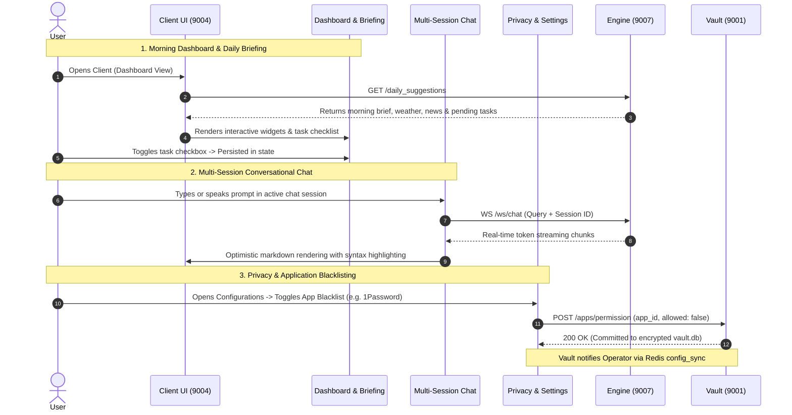

# MIRA Client Module (Desktop & Web Interface)

> **The unified user interaction, intelligence dashboard, multi-session chat, and desktop operating layer for MIRA: bridging background microservices with an intuitive UI and native desktop shell.**

---

## Table of Contents
- [1. Module Overview](#1-module-overview)
- [2. Module Contents](#2-module-contents)
- [3. How It Communicates](#3-how-it-communicates)
- [4. Technology Stack](#4-technology-stack)
- [5. Architecture Flow Diagram](#5-architecture-flow-diagram)

---

<a id="1-module-overview"></a><a id="module-overview"></a>
## 1. Module Overview

### 1.1 Architectural Purpose
The **Client** module is the central command center, user interface, and visual operating layer for the entire MIRA ecosystem. Engineered with **Tauri v2**, **React 19**, **TypeScript**, and **TailwindCSS v4**, it translates complex background activity—such as continuous screen captures, optical character recognition, local vector memories, and multi-provider AI reasoning—into an elegant, responsive desktop workspace. 

The Client operates simultaneously in two modes:
1. **Native Desktop Shell**: Wrapped inside a lightweight Tauri v2 container with native OS window controls, system tray docking, background persistence, and hardware acceleration with a sub-50MB RAM footprint.
2. **Local Web Dashboard**: Accessible in any modern browser at `http://localhost:9004`, providing complete access to conversational chat, daily executive briefs, telemetry graphs, and privacy settings.

Rather than functioning as a basic chatbot wrapper, the Client delivers a comprehensive digital workspace. It serves as your morning dashboard with proactive daily suggestions, your conversational companion with real-time multi-session streaming, your privacy cockpit with application-level screen capture controls, and your system health monitor with live Redis and worker telemetry.

---

### 1.2 Key Capabilities
- **Multi-Session Streaming Chat Hub**: Supports multiple persistent conversation sessions with optimistic UI rendering, real-time WebSocket token streaming, syntax-highlighted code blocks, and unread notification badges.
- **Proactive Daily Intelligence Dashboard**: Synthesizes morning project continuation agendas, pending task checklists with interactive completion tracking, localized weather forecasts, and curated technical news feeds.
- **Granular Privacy & Application Blacklisting**: Allows users to whitelist or blacklist specific applications (e.g. password managers, banking portals) from screen capture with 1-click toggles and customize screen capture intervals.
- **System Telemetry & Microservice Monitor**: Displays live status cards for all six MIRA microservices, Redis Streams queue depths, Pending Entries List (PEL) metrics, active worker pools, and Qdrant vector memory counts.
- **Personalized Work Profile**: Stores user details (name, job title, work preferences, communication style) to tailor AI responses and morning briefings to your specific workflow.
- **Integrated Ambient Voice Engine**: Supports hands-free natural voice interaction with wake-word detection (*"Mira"*), automatic speech gap accumulation, a conversational follow-up window that avoids repeated wake words, and gapless speech playback.
- **Local-First Zero Cloud Harvesting Guarantee**: Personal notes, screen captures, keystrokes, and documents are never collected, stored, or processed on external cloud servers.

> [!TIP]
> **Unified Installation & Execution**: To install and run the Client alongside the full MIRA ecosystem, see the centralized [Scripts & Installation Guide](../scripts/README.md).

---

<a id="2-module-contents"></a><a id="module-contents"></a>
## 2. Module Contents

### 2.1 Directory & File Manifest
```
Client/
├── public/                     # Static assets, hero banners, favicons, & web icons
│   └── icons/                  # High-resolution logos, banners, & window icons
├── src/                        # React 19 application root
│   ├── assets/                 # SVGs, animations, sound effects, and UI graphics
│   ├── components/             # Reusable UI primitives (buttons, modals, cards, badges)
│   ├── hooks/                  # Custom React hooks (wake-word, speech recognition, window metrics)
│   ├── lib/                    # Shared utility libraries, formatters, and class helpers (cn)
│   ├── modules/                # Specialized client runtime engines
│   │   ├── mic/                # Multi-provider STT engine (Web Speech, Deepgram, Whisper)
│   │   └── voice/              # Web Audio scheduler, TTS streaming worker, gapless playback
│   ├── pages/                  # Primary application views & route components
│   │   ├── About/              # Application credits, version display, and architecture links
│   │   ├── ChatsPage.tsx       # Multi-session streaming conversational AI interface
│   │   ├── Configurations/     # System settings, AI keys, blacklist, workers, & audit logs
│   │   │   ├── AiConfig/       # Gemini & Groq API key configuration, testing, & prioritization
│   │   │   ├── Capture/        # Screen capture frequency slider & application blacklisting
│   │   │   ├── Logs/           # Filterable, paginated Vault audit trail explorer
│   │   │   ├── Microphone/     # Audio hardware selection, gain controls, & ambient engine setup
│   │   │   ├── Redis/          # Redis Streams consumer group telemetry & queue depth inspector
│   │   │   └── Workers/        # Background OCR worker concurrency & batch size tuning
│   │   ├── Mira/               # Morning briefing dashboard, daily suggestions, news, & weather
│   │   ├── Tools/              # Fullscreen standalone news reader and diagnostic tools
│   │   └── User/               # Encrypted profile settings, persona tuning, & user preferences
│   ├── services/               # REST API client services mapping to backend microservices
│   ├── store/                  # Zustand state stores (useChatStore, useSettingsStore, etc.)
│   ├── types/                  # Global TypeScript interfaces, API schemas, & state types
│   ├── App.tsx                 # Root layout, navigation sidebar, and dynamic route switcher
│   ├── index.css               # Tailwind CSS v4 design system, glassy tokens, and animations
│   └── main.tsx                # React DOM root bootstrapping & TanStack Query client setup
├── src-tauri/                  # Tauri v2 native desktop application shell
│   ├── capabilities/           # Security permissions, window boundaries, & shell plugins
│   ├── src/                    # Rust entrypoint, backend process supervisor, & system tray
│   │   ├── main.rs             # Tauri application runner entrypoint
│   │   └── lib.rs              # Backend supervisor (spawns start.py), TCP 9002 check, & tray builder
│   ├── windows/                # Windows-specific installer configurations
│   │   └── hooks.nsh           # NSIS installer & uninstaller integration hooks
│   ├── tauri.conf.json         # Desktop window size, bundle identity, title bar, & menu configs
│   └── Cargo.toml              # Rust desktop packaging dependencies
├── index.html                  # HTML5 entrypoint with Google Fonts and viewport configuration
├── package.json                # Node.js dependencies (React 19, Tailwind v4, Zustand, Lucide)
├── tsconfig.json               # TypeScript compiler rules & path alias definitions
└── vite.config.ts              # Vite 8 bundling pipeline, Tailwind v4 plugin, & dev proxy setup
```

---

### 2.2 Primary Views & Page Architecture
The Client application is structured into five core functional views:

#### 1. MIRA Dashboard (`/mira` — `MiraPage.tsx`)
The home view of MIRA, designed as a morning briefing and productivity cockpit:
- **Welcome Header (`WelcomeHeader.tsx`)**: Displays a personalized greeting based on the time of day, active user profile, and system status indicators.
- **Daily Suggestions Widget (`DailySuggestionsWidget.tsx`)**: Highlights automatically generated project continuity items, prioritized task checklists with interactive completion toggles, and summaries of past work sessions.
- **Weather Widget (`WeatherWidget.tsx`)**: Provides real-time localized weather data, current temperature, humidity, wind conditions, and a multi-day forecast.
- **News Feed Widget (`NewsWidget.tsx`)**: Displays curated technical and industry news with category filtering, published timestamps, and direct link navigation.

#### 2. Multi-Session Chat Hub (`/chats` — `ChatsPage.tsx`)
The primary AI reasoning and conversation interface:
- **Multi-Session Sidebar**: Create new conversation threads, search past chat history, switch between active sessions, and delete obsolete transcripts.
- **Unread Badge Indicators**: Tracks unread response counters per session, ensuring you never miss a background response.
- **Streaming Response Renderer (`ChatMessageContent.tsx`)**: Renders markdown in real time with syntax-highlighted code blocks, copy-to-clipboard actions, tables, and mathematical formatting.
- **Optimistic UI & Input Bar (`MessageBar.tsx`)**: Provides responsive message dispatching, typing indicators, auto-resizing text inputs, and integrated voice capture toggles.

#### 3. System Configurations & Security (`/configurations` — `ConfigurationsPage.tsx`)
Central administrative panel providing granular control over the ecosystem:
- **Activity Control (`Capture/`)**: Configure the native screen capture cadence via a duration slider (5s to 60s) and manage the master application permissions table (whitelist/blacklist individual apps from being captured).
- **AI Provider Priority (`AiConfig/`)**: Configure API credentials for Google Gemini and Groq, mask sensitive keys, test provider latency, and reorder failover priorities via drag-and-drop.
- **Worker Concurrency (`Workers/`)**: Fine-tune background OCR extraction worker pools, knowledge base batch sizes, and polling intervals.
- **Redis Streams Monitor (`Redis/`)**: Live inspection of Redis consumer groups, Pending Entries List (PEL) message depths, acknowledged job cleanup, and full queue format triggers.
- **Encrypted Audit Logs (`Logs/`)**: Searchable, paginated audit trail viewer with severity level filters (`INFO`, `WARN`, `ERROR`), service filters, and automated retention rule configuration.
- **Microphone Hardware Settings (`Microphone/`)**: Master toggle for acoustic capture, input device selection, and auto-start on boot controls.

#### 4. User Profile & Personalization (`/user` — `UserPage.tsx`)
- Manages user identity, professional title, working preferences, and personalized prompt instructions.
- All profile fields are encrypted by Vault and injected as conversational context to shape the tone and detail level of AI responses.

#### 5. Tools & Standalone News (`/tools` — `ToolsPage.tsx`)
- Full-screen dedicated news explorer and specialized developer utilities.

---

### 2.3 Frontend Subsystems & State Management
- **Zustand State Stores (`src/store/`)**:
  - `useChatStore.ts`: Manages active chat sessions, in-flight streaming message buffers, session message histories, and unread counters.
  - `useSettingsStore.ts`: Caches microservice endpoints, application blacklist registries, active AI providers, and UI preferences.
  - `useTelemetryStore.ts`: Polls and updates microservice health metrics, Redis queue depths, and worker pool statuses.
- **Dynamic Port Resolution**: On boot, reads `services.json` to dynamically resolve sibling microservice addresses, adapting automatically if ports are incremented due to conflicts.
- **Glassmorphic Design System**: Custom TailwindCSS v4 theme utilizing sleek dark-mode palettes (`#080c14`), translucent glass cards, radial gradients, and fluid layout transitions.

---

### 2.4 Integrated Ambient Voice & Audio Engine
The Client houses a modular acoustic engine supporting multiple input and output modalities:
- **Tri-Provider Speech-to-Text Pipeline (`modules/mic/`)**:
  - *Browser Speech Provider*: Zero-configuration client-side speech recognition via native Web Speech API.
  - *ElevenLabs Realtime Scribe*: Ultra-low latency cloud streaming transcription with proactive multi-key rotation and automatic character quota tracking (`keyQuotaManager.ts`).
  - *OS Native Neural STT*: 100% offline, local on-device transcription routed directly to Engine's Faster-Whisper service, eliminating external cloud dependency.
- **Voice Activity Detection & Gap Accumulator**: Utilizes a 1.5-second speech gap accumulator to ensure natural mid-sentence pauses do not cut off user prompts.
- **Wake-Word Engine ("Mira")**: Continuously monitors transcript streams for the wake-word regex (`mira|meera|mera|myra|मीरा`), cleanly stripping prefixes to isolate user intent.
- **Conversational Awake State Machine**:
  - *Standby*: Saying *"Mira"* activates listening, creates a new chat session, and submits the prompt.
  - *Awake Window*: Once the assistant finishes speaking, an awake follow-up window opens automatically.
  - *Follow-Up Dialogue*: Follow-up queries spoken during this window route into the **same chat session without re-saying the wake word**.
  - *Silence Timeout*: If no speech is detected, the window closes and resets to idle standby.
- **Voice Playback Overlay & Queue (`modules/voice/`)**: Interactive floating voice playback bar (`VoicePlaybackOverlay.tsx`) with animated soundwave visualizer, sentence chunk FIFO playback queue, and acoustic loopback prevention (auto-muting microphone while speaking).

---

### 2.4 Native Desktop Shell (Tauri v2)
- **Zero-Overhead Webview**: Replaces heavyweight Chromium instances with the operating system's native webview (WebKit on macOS/Linux, WebView2 on Windows), keeping RAM usage below 50MB.
- **Native System Tray Integration**: Minimizes to the OS system tray with custom context menus to pause screen capture, toggle the microphone, or open settings.
- **Window Lifecycle & IPC Handlers (`src-tauri/src/main.rs`)**: Manages custom borderless window frames, window dragging, minimize/maximize animations, and secure inter-process communication.

---

<a id="3-how-it-communicates"></a><a id="how-it-communicates"></a>
## 3. How It Communicates

### 3.1 Incoming Endpoints & Ports
| Port | Protocol | Path | Description & Usage |
| :--- | :--- | :--- | :--- |
| **`9004`** | `HTTP` | `/` | Web dashboard application server (served via Vite dev server or static Tauri webview). |
| **`9004`** | `WS` | `/` | Vite Hot Module Replacement (HMR) WebSocket channel during local development. |

---

### 3.2 Outgoing Microservice Communication

#### 1. Vault Service (Port `9001` — Security & Configuration Authority)
| Method | Endpoint | Purpose & Usage |
| :--- | :--- | :--- |
| `GET` | `/config/{module}` | Retrieves verified settings for a specific module (`operator`, `logs`, etc.). |
| `POST` | `/config/{module}` | Updates settings and application permission lists. |
| `GET` | `/user` / `POST` `/user` | Fetches and updates encrypted user profile data (name, title, preferences). |
| `GET` | `/ai/configs` | Retrieves active AI provider credentials with safely masked keys. |
| `GET` | `/ai/priorities` | Reads the current AI model failover sequence (e.g. Gemini $\to$ Groq). |
| `PUT` | `/ai/priorities` | Updates the active provider failover priority order. |
| `GET` | `/logs` | Queries encrypted system audit trails for the Telemetry and Logs dashboards. |
| `DELETE`| `/logs` | Clears audit logs or enforces retention rules. |

#### 2. Message Broker Service (Port `9002` — Event Hub Telemetry)
| Method | Endpoint | Purpose & Usage |
| :--- | :--- | :--- |
| `GET` | `/health` | Verifies Redis connectivity and Message Broker uptime. |
| `GET` | `/redis/consumer-groups` | Fetches live queue depths, pending entries (PEL), and active consumer counts. |
| `POST` | `/redis/clean` | Flushes acknowledged stream entries during queue maintenance. |
| `POST` | `/redis/format` | Full administrative reset of Redis stream keys. |

#### 3. Operator Service (Port `9003` — Native Screen & OS Controls)
| Method | Endpoint | Purpose & Usage |
| :--- | :--- | :--- |
| `GET` | `/status` | Monitors screen capture timer state, active interval, and foreground window. |
| `POST` | `/start` / `POST` `/stop` | Starts or pauses background desktop screen capture. |
| `POST` | `/interval` | Updates screen capture cadence (`{"capture_interval_secs": 15}`). |
| `GET` | `/apps` | Lists installed system applications and their permission status. |
| `POST` | `/apps/permission` | Whitelists or blacklists a specific application from screen capture. |
| `GET` | `/microphone/status` | Queries global microphone hardware recording state. |
| `POST` | `/microphone/start` | Enables microphone audio ingress. |
| `POST` | `/microphone/stop` | Suspends microphone capture across all background threads. |

#### 4. Memory Service (Port `9006` — Perceptual Recall & Vector Store)
| Method | Endpoint | Purpose & Usage |
| :--- | :--- | :--- |
| `GET` | `/status` | Telemetry on visual difference thresholds and active OCR workers. |
| `GET` | `/knowledge-base` | Lists active Qdrant vector collections, document counts, and storage metrics. |
| `DELETE`| `/knowledge-base/{name}`| Deletes an obsolete vector collection partition. |
| `POST` | `/extract` | Dispatches manual diagnostic semantic vector similarity queries. |

#### 5. Engine Service (Port `9007` — AI Reasoning & Streaming Chat)
| Method | Endpoint | Purpose & Usage |
| :--- | :--- | :--- |
| `WS` | `/ws/chat` | Bidirectional streaming WebSocket delivering chunk-by-chunk conversational replies. |
| `GET` | `/chats/sessions` | Retrieves all saved chat sessions with message counts and timestamps. |
| `GET` | `/chats/sessions/{id}`| Loads conversation message history for a specific chat. |
| `POST` | `/chats/message` | Sends a user message via REST and triggers multi-turn context formulation. |
| `DELETE`| `/chats/sessions/{id}`| Permanently removes a chat session. |
| `GET` | `/daily_suggestions` | Fetches synthesized morning agenda, weather forecast, news, and tasks. |
| `POST` | `/daily_suggestions/refresh`| Manually forces re-generation of daily suggestions. |

---

### 3.3 Message Broker & Cloud Integrations
- **Live Queue Monitoring**: The Client regularly inspects `GET /redis/consumer-groups` on the Message Broker to render real-time queue depths and consumer status lights on the Telemetry page.
- **Hot Configuration Sync**: When users update settings in the Client UI, Vault commits the change and publishes a `config_sync` event over Redis Streams, prompting sibling services to reload immediately without process restarts.
- **ElevenLabs Speech Services**: Direct WebSocket streaming connection for speech transcription (`wss://api.elevenlabs.io/v1/convai/conversation`).

---

<a id="4-technology-stack"></a><a id="technology-stack"></a>
## 4. Technology Stack

| Domain | Technology / Library | Version | Architectural Rationale |
| :--- | :--- | :--- | :--- |
| **Desktop Host** | **Tauri v2** | `^2.0.0` | Native OS webview host delivering sub-50MB RAM footprint, system tray hooks, and secure IPC. |
| **Frontend Framework** | **React 19** | `^19.0.0` | High-speed component rendering, concurrent transitions, and modern hook abstractions. |
| **Language** | **TypeScript** | `^5.6.0` | End-to-end type safety across API response contracts, Zustand stores, and UI props. |
| **Styling & Design** | **TailwindCSS v4** | `^4.0.0` | Modern utility CSS engine with dark mode styling, glassmorphism, and responsive layouts. |
| **Build Tooling** | **Vite** | `^6.0.0` | Sub-second hot module replacement (HMR) and optimized Rollup desktop bundle generation. |
| **State Management** | **Zustand** | `^5.0.0` | Unopinionated, lightweight state stores for chats, settings, and telemetry without boilerplate. |
| **Audio Processing** | **Web Audio API** | Native | Hardware-clock scheduled FIFO audio buffers for gapless neural speech playback. |
| **Background Threading** | **Web Workers** | Native | Multi-threaded background sentence chunking and TTS pre-fetching in `tts.worker.ts`. |
| **Icons & Visuals** | **Lucide React** | `^0.469.0` | Clean, lightweight icon suite for all navigation, telemetry, and action elements. |

---

<a id="5-architecture-flow-diagram"></a><a id="architecture-flow-diagram"></a>
## 5. Architecture Flow Diagram


