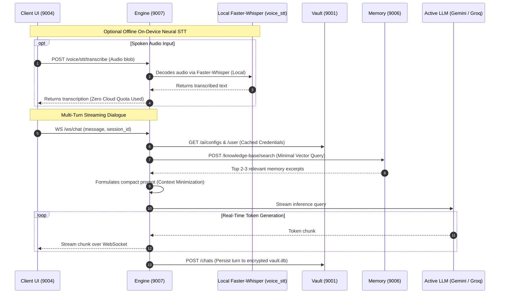

# MIRA Engine Module (AI Orchestration & Intelligence Layer)

> **The cognitive core of MIRA: coordinating LLM inference, multi-turn conversational dialogue, on-device neural STT, real-time context minimization, screen OCR summarization, and proactive daily executive briefings.**

---

## Table of Contents
- [1. Module Overview](#1-module-overview)
- [2. Module Contents](#2-module-contents)
- [3. How It Communicates](#3-how-it-communicates)
- [4. Technology Stack](#4-technology-stack)
- [5. Architecture Flow Diagram](#5-architecture-flow-diagram)

---

<a id="1-module-overview"></a><a id="module-overview"></a>
## 1. Module Overview

### 1.1 Architectural Purpose
The **Engine** module is the cognitive reasoning, artificial intelligence orchestration, and acoustic transcription microservice of MIRA, running on port **`9007`**. In an autonomous personal OS that continuously observes desktop activity and processes natural language, the Engine acts as the central brain. It coordinates inference calls across cloud LLM providers, hosts high-speed WebSocket streaming for multi-turn user conversations, executes local on-device neural speech-to-text (Faster-Whisper), generates dense vector representations using local deep learning models, and runs background analytical workers that condense hours of desktop activity into searchable memory digests.

The Engine is constructed around the principle of **Context Minimization**: rather than transmitting massive, unvetted timelines of raw user screens to external cloud APIs, it acts as an intelligent intermediary. It queries local semantic vector collections in the Memory module, extracts only the minimal relevant text snippets needed to answer a query, and streams conversational replies back to the Client.

---

### 1.2 Key Capabilities
- **Multi-Provider LLM Orchestrator**: Unifies Google Gemini (`google-genai`) and Groq LPU acceleration (`groq`) behind a standardized interface with automated quota failover (`429` retry) and dynamic model priority re-ranking.
- **Real-Time Streaming Chat Engine**: Exposes both bidirectional WebSocket channels (`/ws/chat`) and REST routes for multi-turn dialogues, featuring optimistic rendering and unread state tracking.
- **On-Device Neural STT Service (`voice_stt/`)**: Provides offline, privacy-first speech-to-text using **Faster-Whisper** and native OS microphone audio capture (`sounddevice`), eliminating cloud dependencies for voice recognition.
- **Context Minimization Gateway**: Restricts LLM prompts strictly to the single most relevant 2-3 sentence context excerpt retrieved from local vector storage, preventing prompt bloat and safeguarding user privacy.
- **Autonomous OCR Summarization Worker**: Consumes raw extracted screen text from Message Broker Redis streams, batches activity across applications, and generates compact semantic session summaries.
- **Local Dense Embedding Pipeline**: Executes local PyTorch embeddings (`Qwen/Qwen3-Embedding-0.6B`) using `sentence-transformers`, avoiding cloud dependency for vector mathematics.
- **Proactive Daily Executive Briefings**: Synthesizes morning project continuation agendas, unfinished task checklists, localized weather forecasts, and curated technical news summaries.
- **Dynamic Vault Synchronization**: Binds to Vault at boot to ingest API credentials and subscribes to Message Broker update events to reload keys without process restarts.

> [!TIP]
> **Unified Installation & Execution**: To install and run the Engine alongside the full MIRA ecosystem, see the centralized [Scripts & Installation Guide](../scripts/README.md).

---

<a id="2-module-contents"></a><a id="module-contents"></a>
## 2. Module Contents

### 2.1 Directory & File Manifest
```
Engine/
├── chat/                         # Multi-turn chat & conversational workflows
│   ├── router.py                 # REST & WebSocket endpoints (/chats/message, /ws/chat)
│   ├── workflow/                 # Central LangGraph workflow (decision, weather, news, synthesis)
│   ├── mira_assistant/           # Native MIRA tool: Daily suggestions, API keys, configs, streams, KB
│   │   ├── node.py               # LangGraph node dispatcher
│   │   ├── operations.py         # Direct reading & updating of daily suggestions, keys, configs, streams
│   │   ├── detection.py          # Fast 0ms intent & operational detection
│   │   ├── executor.py           # Non-destructive project code modification & verification
│   │   ├── guidance.py           # Knowledge base guidance synthesizer
│   │   ├── retrieval.py          # Master Knowledge Base Qdrant hybrid search & source inspection
│   │   └── safety.py             # Path validation & strict deletion restriction enforcement
│   ├── websocket.py              # Real-time WebSocket connection manager & telemetry broadcast
│   └── worker.py                 # Message Broker background consumer worker
├── voice_stt/                    # On-device neural speech recognition
│   ├── router.py                 # REST & WebSocket endpoints for local audio transcription
│   ├── stt_service.py            # Faster-Whisper local model loader & audio decoding
│   └── native_mic.py             # Host microphone audio streaming via sounddevice
├── daily_suggestions/            # Proactive intelligence & briefing pipelines
│   ├── daily_suggestions.py      # Suggestion synthesis, project continuity, & task generation
│   ├── news_fetcher.py           # GNews API integration & keyword filtering
│   ├── weather_fetcher.py        # IP-based geolocation & Open-Meteo weather forecasting
│   └── worker.py                 # Daily suggestions scheduler & cache manager
├── ocr_summarization/            # Screen OCR batching & session summarization
│   ├── batch_manager.py          # Application-based temporal session grouping
│   ├── summarizer.py             # LLM prompt pipeline generating concise activity digests
│   └── worker.py                 # Message Broker consumer worker for 'ocr_summarization'
├── embedding/                    # Dense semantic vector generation
│   ├── local_embedding.py        # Local Qwen3-Embedding-0.6B PyTorch transformer pipeline
│   └── worker.py                 # Message Broker publisher pushing vectors to 'embedding_memory'
├── llm/                          # Unified multi-provider LLM abstraction
│   ├── provider_manager.py       # Failover logic, provider priority switching, & quota retry
│   ├── gemini_client.py          # Google Gemini 1.5/2.0 Flash integration
│   └── groq_client.py            # Groq LPU ultra-fast inference integration
├── app.py                        # FastAPI application entry point, lifecycle, & WebSocket routes
├── config.py                     # Service discovery (services.json), Vault sync, & server ports
├── requirements.txt              # Python package requirements
└── vault_logger.py               # Structured logging forwarder to Vault audit logs
```

---

### 2.2 Core Subsystems & Components

#### 1. Real-Time Streaming Chat (`chat/`)
- **`chat_manager.py`**: Manages persistent conversation sessions, computes optimistic unread message counts, fetches session histories from Vault, and injects user personalization context.
- **`streaming.py`**: Handles asynchronous token-by-token streaming over `/ws/chat`, buffering chunks to ensure smooth UI delivery.
- **`context_builder.py`**: Encapsulates the context formulation pipeline. Takes the user's latest query, retrieves relevant activity snippets from the Memory vector store, and builds a compact prompt.

#### 2. On-Device Neural Speech Recognition (`voice_stt/`)
- **`stt_service.py`**: Loads a local **Faster-Whisper** neural transcription model into host memory. Decodes raw 16 kHz audio blobs with zero external network transmission, providing 100% private, cloud-free speech-to-text.
- **`native_mic.py`**: Interfaces directly with native host audio hardware using `sounddevice` to stream microphone audio into the local transcription pipeline.
- **`router.py`**: Exposes `/voice/stt/transcribe` for file uploads, `/voice/stt/mic/start` for continuous recording, and `/voice/stt/events` for WebSocket speech streaming.

#### 3. LLM Provider Orchestrator (`llm/`)
- **`provider_manager.py`**: Dynamically routes inference between Google Gemini and Groq based on priority rankings in Vault.
- Automatically handles API rate limits (`429 Too Many Requests`) by switching to the next healthy provider in sequence without interrupting the active user session.

#### 4. Activity Summarization & Embedding (`ocr_summarization/` & `embedding/`)
- **`ocr_summarization/worker.py`**: Background worker consuming extracted OCR text from the Message Broker's `ocr_summarization` stream.
- **`batch_manager.py`**: Accumulates frames from the same application into logical work sessions, discarding transient micro-switches.
- **`embedding/local_embedding.py`**: Computes 1024-dimensional dense vectors using a local HuggingFace PyTorch model (`Qwen/Qwen3-Embedding-0.6B`) and pushes them to the `embedding_memory` stream.

#### 5. Proactive Intelligence & Daily Briefings (`daily_suggestions/`)
- **`daily_suggestions.py`**: Synthesizes morning project continuation agendas and task lists by analyzing the previous day's vector memories.
- **`news_fetcher.py` & `weather_fetcher.py`**: Gathers localized weather and curated technical news to embed within the executive morning brief.

---

<a id="3-how-it-communicates"></a><a id="how-it-communicates"></a>
## 3. How It Communicates

### 3.1 Incoming Endpoints & Ports
The Engine service listens on port **`9007`** and exposes the following HTTP and WebSocket endpoints:

| Method | Endpoint | Description & Usage |
| :--- | :--- | :--- |
| `GET` | `/health` | Health check verifying that the Engine microservice is online (`{"service": "Engine", "status": "online"}`). |
| `GET` | `/status` | Telemetry endpoint reporting provider priority, model availability, and worker statuses. |
| `WS` | `/ws/chat` | Bidirectional WebSocket stream delivering real-time LLM token responses directly to the Client. |
| `POST` | `/chats/message` | REST endpoint for sending a message and receiving a complete conversational response. |
| `GET` | `/chats/sessions` | Lists all conversational chat sessions stored in Vault. |
| `GET` | `/chats/sessions/{id}` | Fetches message history for a specific chat session. |
| `DELETE`| `/chats/sessions/{id}` | Permanently deletes a chat session and its associated messages. |
| `GET` | `/voice/stt/status` | Reports on-device Faster-Whisper model readiness, microphone running state, and audio device parameters. |
| `POST` | `/voice/stt/transcribe` | Uploads an audio file or blob for offline, local Faster-Whisper transcription (100% private). |
| `POST` | `/voice/stt/mic/start` | Activates native host microphone listening in background. |
| `POST` | `/voice/stt/mic/stop` | Deactivates native host microphone listening. |
| `WS` | `/voice/stt/events` | WebSocket channel streaming real-time transcription events to connected clients. |
| `GET` | `/daily_suggestions` | Retrieves the latest synthesized morning briefing and task list. |
| `POST` | `/daily_suggestions/refresh` | Manually forces re-generation of the daily suggestions briefing. |
| `GET` | `/daily_suggestions/weather` | Returns current weather and localized forecast data. |
| `GET` | `/daily_suggestions/news` | Returns curated news articles based on user interests. |
| `POST` | `/llm/generate` | Direct generation endpoint for executing single-prompt completions against the active LLM. |
| `GET` | `/llm/providers` | Lists configured LLM providers and their operational health. |
| `POST` | `/embedding/generate` | Generates a dense vector embedding for arbitrary input text using the local model. |
| `POST` | `/workers/start` | Starts the OCR summarization and daily suggestions background workers. |
| `POST` | `/workers/stop` | Pauses the OCR summarization and daily suggestions background workers. |

---

### 3.2 Outgoing Microservice Communication
The Engine initiates outbound REST requests to three sibling services:

#### 1. Vault Service (Port `9001`)
| Method | Endpoint | Purpose & Usage |
| :--- | :--- | :--- |
| `GET` | `/ai/configs` | Fetches active AI provider credentials (Gemini, Groq API keys). |
| `GET` | `/ai/priorities` | Reads the active LLM failover priority order. |
| `GET` | `/user` | Ingests the encrypted user profile to personalize chat responses. |
| `GET` | `/chats/sessions` / `POST` `/chats` | Reads and updates encrypted chat session transcripts in SQLite. |
| `POST` | `/logs` | Dispatches operational diagnostic events to the encrypted audit log. |

#### 2. Memory Service (Port `9006`)
| Method | Endpoint | Purpose & Usage |
| :--- | :--- | :--- |
| `POST` | `/knowledge-base/search` | Dispatches dense query vectors to search local Qdrant collections for relevant past context. |

#### 3. Message Broker Service (Port `9002`)
| Method | Endpoint | Purpose & Usage |
| :--- | :--- | :--- |
| `GET` | `/jobs` | Polls pending OCR jobs from the `ocr_summarization` stream. |
| `DELETE`| `/jobs` | Acknowledges (`XACK`) and deletes processed OCR summarization jobs. |
| `POST` | `/jobs` | Publishes synthesized embeddings and metadata to the `embedding_memory` stream. |

---

### 3.3 Message Broker & Redis Streams Integration
Engine acts as both a consumer and producer across Redis Streams:

| Stream / Consumer Key | Role | Consumer Group | Payload Content |
| :--- | :--- | :--- | :--- |
| **`ocr_summarization`** | **Consumer** | `CONSUMER_GROUP_OCR_TEXT_SUMMARIZATION` | Structured OCR output containing `extracted_text`, `ui_regions`, `app_name`, and `timestamp`. |
| **`embedding_memory`** | **Producer** | `CONSUMER_GROUP_EMBEDDING_MEMORY` | Summarized activity records containing dense embedding vectors (`1024-dim`), ready for Qdrant storage. |
| **`config_sync`** | **Consumer** | Dynamic Subscriptions | Listens for configuration updates from Vault to hot-reload AI keys and priorities without restart. |

---

<a id="4-technology-stack"></a><a id="technology-stack"></a>
## 4. Technology Stack

| Domain | Technology / Library | Version | Architectural Rationale |
| :--- | :--- | :--- | :--- |
| **API Framework** | **FastAPI** | `^0.110.0` | High-throughput asynchronous routing, WebSocket server, and Pydantic validation. |
| **ASGI Server** | **Uvicorn** | `^0.28.0` | Asynchronous runtime powering concurrent WebSockets and long-running workers. |
| **Cloud LLM (Google)** | **google-genai** | `^0.1.1` | Native SDK for Gemini 1.5/2.0 Flash with low-latency streaming and high context limits. |
| **Cloud LLM (Groq)** | **groq** | `^0.9.0` | Ultra-fast LPU inference engine for near-instant conversational responses. |
| **On-Device Neural STT** | **faster-whisper** | `^1.0.0` | CTranslate2-accelerated local Whisper models for private, zero-cloud audio transcription. |
| **Audio Hardware Capture** | **sounddevice** | `^0.4.6` | PortAudio bindings capturing raw 16 kHz PCM microphone streams from host OS. |
| **Local Embeddings** | **PyTorch & Transformers** | `^2.2.0` | On-device execution of `Qwen/Qwen3-Embedding-0.6B` dense vector models. |
| **Data Validation** | **Pydantic v2** | `^2.6.0` | Strict typing and validation for chat payloads and configuration models. |
| **HTTP Client** | **Requests / httpx** | `^2.31.0` | Outbound communication to Vault, Memory, and Message Broker. |

---

<a id="5-architecture-flow-diagram"></a><a id="architecture-flow-diagram"></a>
## 5. Architecture Flow Diagram


