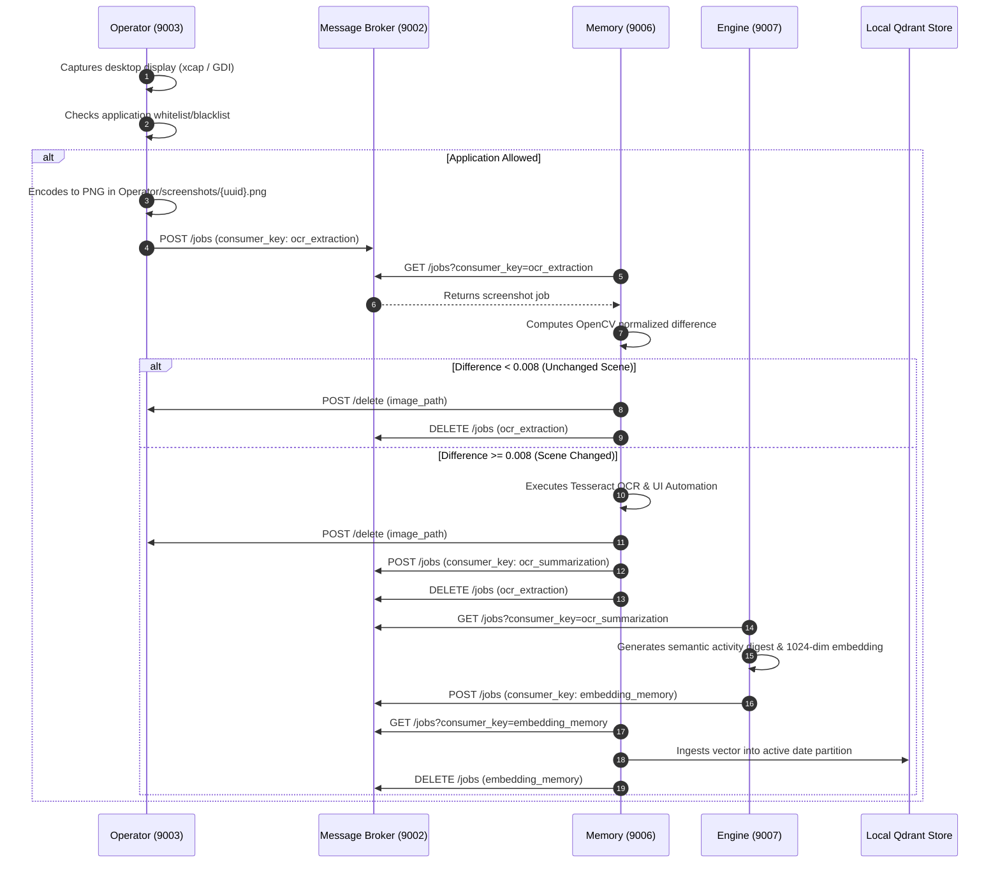
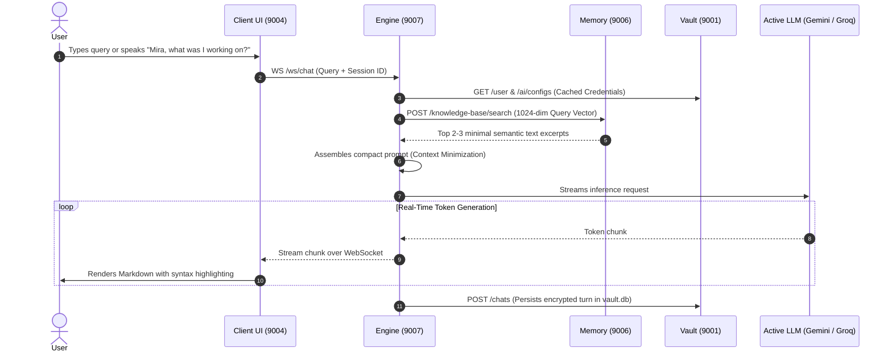
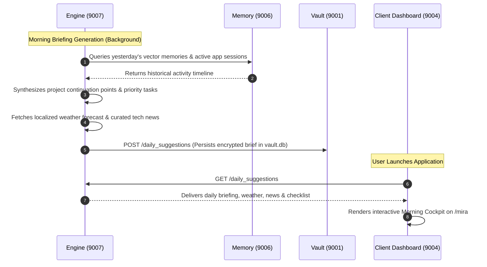
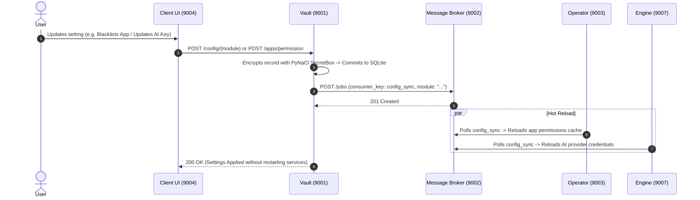

# MIRA Master Knowledge Base (Systematic Architecture & Reference Manual)

> **The comprehensive, single-source-of-truth knowledge base for the entire MIRA ecosystem: synthesizing all microservices, code architectures, network communication protocols, cryptographic foundations, data pipelines, orchestration workflows, and complete end-user guides.**

---

## Table of Contents
- [1. Executive System Overview](#1-executive-system-overview)
- [2. Microservice Architecture Matrix](#2-microservice-architecture-matrix)
- [3. Subsystem Deep Dives & Code Architecture](#3-subsystem-deep-dives--code-architecture)
  - [3.1 Client Module (Desktop GUI & Multi-Session Chat)](#31-client-module-desktop-gui--multi-session-chat)
  - [3.2 Engine Module (LLM Reasoning & Neural STT)](#32-engine-module-llm-reasoning--neural-stt)
  - [3.3 Memory Module (Perceptual Vision & Qdrant Store)](#33-memory-module-perceptual-vision--qdrant-store)
  - [3.4 Operator Module (Native Rust Screen Capture)](#34-operator-module-native-rust-screen-capture)
  - [3.5 Vault Module (Encrypted Secrets & Authority)](#35-vault-module-encrypted-secrets--authority)
  - [3.6 Message Broker Module (Redis Streams Fabric)](#36-message-broker-module-redis-streams-fabric)
  - [3.7 Scripts & Orchestration Toolkit](#37-scripts--orchestration-toolkit)
- [4. Inter-Service Communication & Network Topology](#4-inter-service-communication--network-topology)
  - [4.1 Port Map & Dynamic Allocation](#41-port-map--dynamic-allocation)
  - [4.2 Redis Streams Event Bus](#42-redis-streams-event-bus)
  - [4.3 Real-Time WebSocket Channels](#43-real-time-websocket-channels)
- [5. Security, Cryptography & Privacy Blueprint](#5-security-cryptography--privacy-blueprint)
- [6. End-to-End Data Flow Pipelines](#6-end-to-end-data-flow-pipelines)
  - [6.1 Continuous Visual Perception Pipeline](#61-continuous-visual-perception-pipeline)
  - [6.2 Multi-Turn Conversational Reasoning Pipeline](#62-multi-turn-conversational-reasoning-pipeline)
  - [6.3 Proactive Daily Briefing Pipeline](#63-proactive-daily-briefing-pipeline)
  - [6.4 Zero-Downtime Configuration Sync Pipeline](#64-zero-downtime-configuration-sync-pipeline)
- [7. Master Technology Stack](#7-master-technology-stack)
- [8. Unified Installation & Quickstart](#8-unified-installation--quickstart)
- [9. Comprehensive End-User Guide & Operations Manual](#9-comprehensive-end-user-guide--operations-manual)
  - [9.1 Morning Dashboard & Briefing Cockpit (`/mira`)](#91-morning-dashboard--briefing-cockpit-mira)
  - [9.2 Multi-Session Conversational Chat (`/chats`)](#92-multi-session-conversational-chat-chats)
  - [9.3 Technical News Reader & Explorer (`/tools/news`)](#93-technical-news-reader--explorer-toolsnews)
  - [9.4 Daily Suggestions & Task Management](#94-daily-suggestions--task-management)
  - [9.5 Managing AI Providers & API Keys (Zero-Code Guide)](#95-managing-ai-providers--api-keys-zero-code-guide)
  - [9.6 Privacy Boundaries & Screen Capture Blacklisting](#96-privacy-boundaries--screen-capture-blacklisting)
  - [9.7 Ambient Voice & Wake-Word Controls](#97-ambient-voice--wake-word-controls)
  - [9.8 User Troubleshooting & Frequently Asked Questions (FAQ)](#98-user-troubleshooting--frequently-asked-questions-faq)
- [10. Repository Documentation Sitemap](#10-repository-documentation-sitemap)

---

<a id="1-executive-system-overview"></a>
## 1. Executive System Overview

**MIRA** (**M**emory, **I**ntelligence, **R**ecall, **A**ssistant) is an autonomous, decentralized, privacy-first personal AI operating system and ambient digital memory. Rather than acting as an isolated chatbot waiting passively for typed prompts, MIRA runs locally across distributed background microservices to continuously observe your desktop workflow, index meaningful digital context into encrypted semantic vector storage, and proactively assist you throughout your day.

### Core Architectural Axioms
1. **Local-First Machine Sovereignty**: Screen captures, optical character recognition outputs, activity digests, user preferences, and vector collections reside strictly on your physical machine. No personal data, documents, or screenshots are ever harvested, stored, or processed on remote cloud servers.
2. **Context Minimization**: When conversational reasoning requires cloud LLM intelligence (Google Gemini, Groq), MIRA queries its local vector memory first, extracts only the minimal relevant 2-3 sentence context excerpt, and transmits that snippet alone—preventing raw desktop history from ever leaving the machine.
3. **Zero-Trust Encrypted Persistence**: All SQLite databases (`vault.db`, `audit_logs.db`) and credentials are cryptographically sealed with authenticated symmetric encryption (**PyNaCl** SecretBox / XSalsa20-Poly1305). The master 32-byte key is derived from the host OS hardware credential store (Apple Keychain, Windows Credential Manager, Linux SecretService).
4. **Decoupled Asynchronous Event Mesh**: Fast native producers (Operator screen capture) and compute-heavy consumers (Memory OCR and Engine summarization) communicate exclusively through **Redis Streams**, eliminating thread blocking and memory spikes.

---

<a id="2-microservice-architecture-matrix"></a>
## 2. Microservice Architecture Matrix

| Module | Default Port | Technology | Primary Role | Documentation Link |
| :--- | :---: | :--- | :--- | :--- |
| **Vault** | `9001` | Python 3.11, FastAPI, SQLite, PyNaCl | Cryptographic authority, hardware keyring, encrypted configs, chat history, audit logs. | [`Vault/README.md`](Vault/README.md) |
| **Message Broker** | `9002` | Python 3.11, FastAPI, Redis Streams | Decoupled event streaming hub, consumer groups (`XREADGROUP`, `XACK`), image cache. | [`Message_Broker/README.md`](Message_Broker/README.md) |
| **Operator** | `9003` | Rust (2021), Tokio, Axum, `xcap` | Low-latency native desktop screen capture, window tracking, per-app privacy guard. | [`Operator/README.md`](Operator/README.md) |
| **Client** | `9004` | Tauri v2, React 19, TypeScript, Tailwind v4 | Desktop GUI, multi-session chat, morning dashboard, privacy controls, ambient voice. | [`Client/README.md`](Client/README.md) |
| **Memory** | `9006` | Python 3.11, FastAPI, OpenCV, Tesseract, Qdrant | OpenCV frame diffing (`0.008` threshold), Tesseract OCR, local Qdrant vector database. | [`Memory/README.md`](Memory/README.md) |
| **Engine** | `9007` | Python 3.11, FastAPI, Faster-Whisper, Gemini, Groq | Cognitive brain, WebSocket streaming (`/ws/chat`), on-device neural STT, daily briefing. | [`Engine/README.md`](Engine/README.md) |
| **Scripts** | N/A | Python 3.11, `psutil`, `socket`, Tauri CLI | Dynamic port conflict resolver, lifecycle supervisor (`start.py`), native packager (`build.py`). | [`scripts/README.md`](scripts/README.md) |

---

<a id="3-subsystem-deep-dives--code-architecture"></a>
## 3. Subsystem Deep Dives & Code Architecture

<a id="31-client-module-desktop-gui--multi-session-chat"></a>
### 3.1 Client Module (Desktop GUI & Multi-Session Chat)
* **Full Documentation**: [`Client/README.md`](Client/README.md)
* **Port**: `9004` (HTTP Web Dashboard & WS Vite HMR)

#### Code Structure & Directory Manifest
```
Client/
├── src/
│   ├── components/               # Modular UI components
│   │   ├── Activity/             # Screen capture history & timeline cards
│   │   ├── Assistant/            # Voice status indicator & audio wave visualization
│   │   ├── Chat/                 # Multi-session chat view, message bubbles, input box
│   │   ├── Insights/             # Daily briefing, weather, news widgets, task lists
│   │   ├── Layout/               # Window titlebar, navigation sidebar, system tray controls
│   │   ├── Settings/             # Microservice port config, AI keys, app permissions
│   │   └── Telemetry/            # Microservice health cards, Redis PEL metrics
│   ├── pages/                    # Primary application views
│   │   ├── ChatsPage.tsx         # Conversational voice and text interface
│   │   ├── InsightsPage.tsx      # Daily executive suggestions dashboard
│   │   ├── SettingsPage.tsx      # Central configuration and administrative controls
│   │   ├── TelemetryPage.tsx     # Redis Streams and worker pool telemetry
│   │   └── UserPage.tsx          # User profile and personalization settings
│   ├── modules/                  # Extensible client runtime engines
│   │   ├── mic/                  # Tri-provider speech-to-text (Browser, ElevenLabs, OS Native)
│   │   └── voice/                # Audio playback overlay, soundwaves, sentence chunk queue
│   ├── store/                    # Zustand reactive state stores
│   │   ├── useChatStore.ts       # Active chat session, streaming buffers, unread badges
│   │   ├── useSettingsStore.ts   # Cached endpoints, app blacklists, provider preferences
│   │   └── useTelemetryStore.ts  # Microservice health, Redis queue depths, worker status
│   ├── services/                 # Unified Axios/Fetch API clients for microservices
│   ├── styles/                   # TailwindCSS v4 custom design tokens and glassmorphism
│   ├── App.tsx                   # Top-level route switch, layout wrapper, and error boundary
│   └── main.tsx                  # React 19 concurrent root mount point
├── src-tauri/                    # Native Tauri v2 desktop shell
│   ├── src/main.rs               # Rust desktop process entry point, system tray, window lifecycle
│   ├── Cargo.toml                # Native desktop dependencies and bundle configuration
│   └── tauri.conf.json           # Window properties, security permissions, bundle identifiers
├── package.json                  # Node.js dependencies, scripts, and build targets
└── vite.config.ts                # Vite 6 dev server, path aliases, Rollup packaging options
```

#### Key Capabilities & Code Architecture
1. **Morning Productivity Cockpit (`/mira` — `MiraPage.tsx`)**: Renders personalized greetings, real-time localized weather (`WeatherWidget.tsx`), curated technical news feeds (`NewsWidget.tsx`), and automated project continuation checklists (`DailySuggestionsWidget.tsx`) with interactive completion tracking.
2. **Multi-Session Chat Hub (`/chats` — `ChatsPage.tsx`)**: Supports multi-threaded conversations with optimistic UI bubbling, real-time WebSocket token streaming, syntax-highlighted code blocks, 1-click clipboard copy, and unread notification badges.
3. **Tri-Provider Acoustic Engine (`modules/mic/` & `modules/voice/`)**:
   - *Browser Speech Provider*: Native Web Speech API for immediate client-side recognition.
   - *ElevenLabs Realtime Scribe*: Ultra-low latency cloud streaming with automatic multi-key rotation (`keyQuotaManager.ts`).
   - *OS Native Neural STT*: Local on-device transcription routed directly to Engine's Faster-Whisper service on port `9007`.
   - *Speech Gap Accumulator & Wake-Word*: Accumulates 1.5s pauses (`SPEECH_GAP_DELAY_MS = 1500`) to prevent mid-sentence cutoffs and triggers on *"Mira"*.
   - *Conversational Awake Follow-Up Window*: Keeps session listening active for follow-ups without repeating the wake word.
4. **Native Desktop Shell (`src-tauri/`)**: Cross-platform desktop application powered by Tauri v2 with native system tray docking, frameless window controls, and a sub-50MB RAM footprint.

---

<a id="32-engine-module-llm-reasoning--neural-stt"></a>
### 3.2 Engine Module (LLM Reasoning & Neural STT)
* **Full Documentation**: [`Engine/README.md`](Engine/README.md)
* **Port**: `9007` (HTTP & WebSockets)

#### Code Structure & Directory Manifest
```
Engine/
├── chat/                         # Multi-turn chat & conversational workflows
│   ├── chat_manager.py           # Session lifecycle, unread counts, and transcript caching
│   ├── streaming.py              # WebSocket token streamer & chunk formatter
│   └── context_builder.py        # Context formulation & Memory vector retrieval
├── voice_stt/                    # On-device neural speech recognition
│   ├── router.py                 # REST & WebSocket endpoints for local audio transcription
│   ├── stt_service.py            # Faster-Whisper local model loader & audio decoding
│   └── native_mic.py             # Host microphone audio streaming via sounddevice
├── daily_suggestions/            # Proactive intelligence & briefing pipelines
│   ├── daily_suggestions.py      # Suggestion synthesis, project continuity, & task generation
│   ├── news_fetcher.py           # GNews API integration & keyword filtering
│   ├── weather_fetcher.py        # IP-based geolocation & Open-Meteo weather forecasting
│   └── worker.py                 # Daily suggestions scheduler & cache manager
├── ocr_summarization/            # Screen OCR batching & session summarization
│   ├── batch_manager.py          # Application-based temporal session grouping
│   ├── summarizer.py             # LLM prompt pipeline generating concise activity digests
│   └── worker.py                 # Message Broker consumer worker for 'ocr_summarization'
├── embedding/                    # Dense semantic vector generation
│   ├── local_embedding.py        # Local Qwen3-Embedding-0.6B PyTorch transformer pipeline
│   └── worker.py                 # Message Broker publisher pushing vectors to 'embedding_memory'
├── llm/                          # Unified multi-provider LLM abstraction
│   ├── provider_manager.py       # Failover logic, provider priority switching, & quota retry
│   ├── gemini_client.py          # Google Gemini 1.5/2.0 Flash integration
│   └── groq_client.py            # Groq LPU ultra-fast inference integration
├── app.py                        # FastAPI application entry point, lifecycle, & WebSocket routes
├── config.py                     # Service discovery (services.json), Vault sync, & server ports
├── requirements.txt              # Python package requirements
└── vault_logger.py               # Structured logging forwarder to Vault audit logs
```

#### Key Capabilities & Code Architecture
1. **Multi-Provider LLM Orchestrator (`llm/`)**: Standardized inference bridge for Google Gemini and Groq LPU with automatic rate-limit (`429`) failover and dynamic priority re-ranking.
2. **Streaming Chat Engine (`chat/`)**: Bidirectional WebSocket endpoint (`/ws/chat`) providing token-by-token conversational streaming and session state management.
3. **On-Device Neural STT Service (`voice_stt/`)**: Local, offline speech-to-text powered by **Faster-Whisper** and host microphone streaming via `sounddevice` (`POST /voice/stt/transcribe`, `WS /voice/stt/events`), offering 100% private, cloud-free voice transcription.
4. **Context Minimization Gateway (`chat/context_builder.py`)**: Restricts prompt injection strictly to the single most relevant 2-3 sentence context excerpt retrieved from Memory vector storage.
5. **OCR Activity Summarizer (`ocr_summarization/`)**: Consumes raw extracted screen text from Message Broker Redis streams, groups frames by application session, and generates compact semantic activity summaries.
6. **Dense Vector Embeddings (`embedding/`)**: Computes 1024-dimensional dense vectors using a local HuggingFace PyTorch model (`Qwen/Qwen3-Embedding-0.6B`) and pushes them to the `embedding_memory` stream.
7. **Proactive Daily Executive Briefings (`daily_suggestions/`)**: Synthesizes morning continuation agendas, pending tasks, weather, and technical news from past activity memories.

---

<a id="33-memory-module-perceptual-vision--qdrant-store"></a>
### 3.3 Memory Module (Perceptual Vision & Qdrant Store)
* **Full Documentation**: [`Memory/README.md`](Memory/README.md)
* **Port**: `9006` (HTTP)

#### Code Structure & Directory Manifest
```
Memory/
├── screenshot_processing/             # Computer vision & OCR extraction engine
│   ├── worker.py                      # Async screenshot worker pool & broker job dispatcher
│   ├── data_extractor.py              # OpenCV matrix math, grayscale extraction, & Tesseract OCR
│   ├── image_comparison.py           # Perceptual diffing & Redis-backed frame history comparison
│   ├── region_comparator.py          # UI bounding box & text similarity analysis
│   └── uia_extractor.py               # Native OS Accessibility & UI Automation bridge
├── knowledge_base/                    # Local Qdrant vector database & collection lifecycle
│   ├── worker.py                      # Background worker ingesting embedding jobs into Qdrant
│   ├── qdrant_store.py                # Embedded Qdrant client, schema indexing, & vector search
│   ├── broker_client.py               # Message Broker polling client for 'embedding_memory' stream
│   ├── storage.py                     # Collection discovery, date-range resolution, & disk metrics
│   ├── protection.py                  # Collection retention enforcement & automated pruning
│   ├── encryption.py                  # Optional AES encryption helpers for vector payloads on disk
│   └── config.py                      # Knowledge base batch sizes, collection paths, & defaults
├── app.py                             # FastAPI application entry point, lifecycle, & HTTP routes
├── config.py                          # Service discovery (services.json), Vault sync, & server ports
├── requirements.txt                   # Python package dependencies
└── vault_logger.py                    # Structured logging forwarder to Vault audit logs
```

#### Key Capabilities & Code Architecture
1. **Perceptual Frame Diffing (`screenshot_processing/image_comparison.py`)**: Computes normalized absolute differences between consecutive grayscale matrices using OpenCV (`calculate_image_difference`). Drops unchanged frames (`diff < 0.008`) to cut OCR compute by >70%.
2. **Structural UI Region Comparator (`screenshot_processing/region_comparator.py`)**: Evaluates bounding box geometry and Levenshtein similarity to filter rapid consecutive repetitive frames within 4 seconds.
3. **High-Accuracy OCR (`screenshot_processing/data_extractor.py`)**: Extracts structured text and UI region categories (`header`, `sidebar`, `content`) via multi-threaded Tesseract OCR with adaptive image pre-processing.
4. **Desktop UI Automation (`screenshot_processing/uia_extractor.py`)**: Queries native Windows UI Automation (UIA) and macOS Accessibility trees for active window titles, tab names, and focused control elements.
5. **Instant Ephemeral Cleanup**: Triggers Operator's `POST /delete` immediately after processing to wipe raw screenshot files from disk.
6. **Local Qdrant Knowledge Base (`knowledge_base/qdrant_store.py`)**: Embedded local Qdrant vector database (`SYSTEM_STORAGE_PATH/knowledge_base`) managing date-partitioned collections (e.g. `kb-24_10_2026-25_10_2026`) indexed with Cosine distance.
7. **Automated Retention Enforcement (`knowledge_base/protection.py`)**: Evaluates retention duration policies (`Never auto delete`, `7 days`, `30 days`) and purges expired vector storage partitions.

---

<a id="34-operator-module-native-rust-screen-capture"></a>
### 3.4 Operator Module (Native Rust Screen Capture)
* **Full Documentation**: [`Operator/README.md`](Operator/README.md)
* **Port**: `9003` (HTTP)

#### Code Structure & Directory Manifest
```
Operator/
├── src/
│   ├── main.rs                   # Process entry point, service bootstrapping, & Axum listener
│   ├── api.rs                    # REST route definitions, request handlers, & state extraction
│   ├── capture.rs                # Native screen capture logic (xcap, GDI, multi-monitor)
│   ├── flow.rs                   # CaptureManager loop, timer scheduler, & capture lifecycle
│   ├── permissions.rs            # Application blacklist/whitelist verification & cache
│   ├── app_discovery.rs          # Cross-platform installed application scanning & icon resolution
│   ├── broker_client.rs          # HTTP client publishing capture jobs to Message Broker
│   ├── microphone.rs             # Microphone hardware capture state & auto-start manager
│   ├── local_state.rs            # Persisted local capture interval & execution state
│   ├── config.rs                 # Dynamic service discovery (services.json) & Vault sync
│   └── vault_logger.rs           # Asynchronous logger dispatching audit events to Vault
├── screenshots/                  # Ephemeral directory for in-flight captured PNG frames
├── operator_state.json           # Cached local interval and runtime configuration
├── Cargo.toml                    # Rust crate definition and dependencies
└── Cargo.lock                    # Locked dependency graph
```

#### Key Capabilities & Code Architecture
1. **Native Hardware Screen Capture (`src/capture.rs`)**: High-speed, non-intrusive desktop frame capture using `xcap` and native Windows GDI/DirectX handles (`windows-sys`), achieving sub-10ms capture cycles with minimal CPU overhead.
2. **Active Window & Process Inspection (`src/permissions.rs`)**: Inspects foreground process ID, executable name, and window title across macOS, Windows, and Linux.
3. **Application Privacy Guard (`src/permissions.rs`)**: Enforces per-application capture permissions stored in Vault. If the active application is blacklisted (e.g. password manager, banking portal), the capture loop immediately drops the frame before it touches disk.
4. **Installed Application Discovery (`src/app_discovery.rs`)**: Scans system registries and manifests (`/Applications`, Windows Registry, `.desktop` files) to compile an exhaustive software catalog synchronized with Vault.
5. **Asynchronous Stream Dispatch (`src/broker_client.rs`)**: Saves captured frames to `Operator/screenshots/` and dispatches structured jobs (`job_id`, `app_name`, `image_path`) directly to Message Broker's `ocr_extraction` stream.
6. **Hardware Microphone Management (`src/microphone.rs`)**: Tracks global microphone capture flags and auto-start preferences.

---

<a id="35-vault-module-encrypted-secrets--authority"></a>
### 3.5 Vault Module (Encrypted Secrets & Authority)
* **Full Documentation**: [`Vault/README.md`](Vault/README.md)
* **Port**: `9001` (HTTP)

#### Code Structure & Directory Manifest
```
Vault/
├── api.py                    # Comprehensive REST route implementations & Pydantic models
├── app.py                    # FastAPI application initialization & Uvicorn startup
├── config.py                 # Service discovery (services.json), directory roots, & defaults
├── config_storage.py         # Encrypted SQLite storage engine & migration controllers
├── crypto.py                 # PyNaCl SecretBox wrapper, keyring key retrieval, & hashing
├── log_manager.py            # Encrypted audit log management & retention pruning engine
├── requirements.txt          # Python package requirements
├── schema.sql                # SQLite database schema definitions
└── system/                   # Encrypted local storage directory (auto-created)
    ├── vault.db              # Encrypted SQLite database file
    ├── audit_logs.db         # Encrypted audit logs database
    └── knowledge_base/       # Root storage path for Qdrant vector partitions
```

#### Key Capabilities & Code Architecture
1. **Hardware-Backed Master Key Derivation (`crypto.py`)**: Integrates with the host OS credential store (`keyring` library targeting Apple Keychain, Windows Credential Manager, or Linux SecretService) to retrieve or generate a cryptographically secure 32-byte master key.
2. **Authenticated Symmetric Encryption (`crypto.py`)**: Seals all database records using **PyNaCl** SecretBox (XSalsa20 stream cipher + Poly1305 MAC) with unique 24-byte nonces.
3. **Configuration Authority (`config_storage.py`)**: Single source of truth serving verified settings for `operator`, `logs`, `message_broker`, `ai_configs`, and `ai_priorities`.
4. **Encrypted Database Storage (`system/vault.db`)**: Houses user profiles, AI credentials, application permission registries, multi-session chat histories, and daily briefings.
5. **Encrypted Audit Logging (`log_manager.py` / `system/audit_logs.db`)**: Ingests, encrypts, and indexes operational diagnostic events from all microservices, enforcing automatic log retention pruning.
6. **Hot Config Event Broadcast**: Dispatches `config_sync` notifications to Message Broker whenever configurations change to trigger zero-downtime hot reloads.

---

<a id="36-message-broker-module-redis-streams-fabric"></a>
### 3.6 Message Broker Module (Redis Streams Fabric)
* **Full Documentation**: [`Message_Broker/README.md`](Message_Broker/README.md)
* **Port**: `9002` (HTTP) & Port `6379` (Redis)

#### Code Structure & Directory Manifest
```
Message_Broker/
├── api.py                    # REST route definitions, request validation, & response handlers
├── app.py                    # FastAPI application setup, lifecycle manager, & Uvicorn listener
├── config.py                 # Redis connection parameters, port discovery, & service URLs
├── consumer_group_manager.py # Automated consumer group bootstrapping & offset management
├── consumer_groups.json      # Stream key to consumer group mapping definitions
├── redis_client.py           # Thread-safe Redis connection pool wrapper
├── redis_service.py          # Redis Streams low-level operations (XADD, XREADGROUP, XACK, PEL)
├── requirements.txt          # Python package requirements
└── vault_logger.py           # Logging forwarder reporting broker health to Vault audit logs
```

#### Key Capabilities & Code Architecture
1. **Redis Streams Event Fabric (`redis_service.py`)**: Wraps Redis Streams (`XADD`, `XREADGROUP`, `XACK`, `XDEL`) behind high-throughput FastAPI endpoints, isolating fast producers from heavy consumers.
2. **At-Least-Once Delivery**: Employs persistent consumer groups with Pending Entries List (PEL) tracking to guarantee no capture or intelligence event is dropped if a worker crashes.
3. **Stream Partitioning (`consumer_groups.json`)**: Manages dedicated stream pipelines (`ocr_extraction`, `ocr_summarization`, `embedding_memory`, `config_sync`).
4. **Queue Telemetry & Maintenance (`api.py`)**: Exposes live queue depth metrics, active worker counts, message PEL inspectors, stream cleaning, and queue formatting.
5. **Transient In-Memory Comparison Cache (`redis_service.py`)**: Maintains fast key-value caches for recent image difference matrices and active chat session states.

---

<a id="37-scripts--orchestration-toolkit"></a>
### 3.7 Scripts & Orchestration Toolkit
* **Full Documentation**: [`scripts/README.md`](scripts/README.md)

#### Code Structure & Directory Manifest
```
scripts/
├── start.py                  # Master lifecycle supervisor, port resolver, & process multiplexer
├── build.py                  # Cross-platform compiler, version bumper, & installer packager
├── services.json             # Dynamic service discovery endpoint registry
├── requirements.txt          # Dependencies for supervisor script (psutil, requests)
└── README.md                 # Master unified installation guide for all operating systems
```

#### Key Capabilities & Code Architecture
1. **Master Lifecycle Supervisor (`scripts/start.py`)**: Auto-detects and launches local Redis instances, checks port availability on sockets `9001`–`9007`, automatically resolves port collisions by incrementing occupied ports, updates `services.json` and `.env.local`, boots microservices in strict dependency order with `/health` polling, multiplexes color-coded log streams, and terminates all child process trees on `Ctrl+C`.
2. **Dynamic Service Discovery Registry (`scripts/services.json`)**: Central JSON endpoint map loaded at boot by all services, completely eliminating hardcoded URLs.
3. **Cross-Platform Compilation & Packaging (`scripts/build.py`)**: Multi-target build orchestrator compiling Operator in Rust, building Client in Vite, staging microservices into Tauri resources, and packaging native desktop installers (Windows NSIS `.exe`, macOS `.dmg`/`.app`, Linux `.deb`/`.AppImage`).
4. **Atomic Version Synchronization (`scripts/build.py`)**: Queries (`-v`) and atomically bumps (`--set-version`) version strings across `tauri.conf.json`, `package.json`, `Client/Cargo.toml`, and `Operator/Cargo.toml`.

---

<a id="4-inter-service-communication--network-topology"></a>
## 4. Inter-Service Communication & Network Topology

<a id="41-port-map--dynamic-allocation"></a>
### 4.1 Port Map & Dynamic Allocation
Every microservice binds to a default port defined in `scripts/services.json`. If a port conflict occurs on launch, `start.py` reallocates the port dynamically:

| Port | Service | Protocol | Key Endpoints | Incoming Callers |
| :---: | :--- | :---: | :--- | :--- |
| **`6379`** | **Redis Server** | `TCP` | Native Redis Streams commands (`XADD`, `XREADGROUP`, `XACK`) | Message Broker (9002) |
| **`9001`** | **Vault** | `HTTP` | `GET /config/{k}`, `GET /ai/configs`, `GET /user`, `POST /logs`, `GET /chats/sessions` | Client, Operator, Memory, Engine, Broker |
| **`9002`** | **Message Broker** | `HTTP` | `POST /jobs`, `GET /jobs`, `DELETE /jobs`, `GET /redis/consumer-groups` | Client, Operator, Memory, Engine, Vault |
| **`9003`** | **Operator** | `HTTP` | `GET /status`, `POST /start`, `POST /stop`, `POST /interval`, `POST /delete`, `GET /apps` | Client (9004), Memory (9006) |
| **`9004`** | **Client UI** | `HTTP / WS` | `GET /` (Webview GUI), `WS /` (Vite HMR) | User Browser, Native Tauri Webview |
| **`9006`** | **Memory** | `HTTP` | `GET /status`, `GET /knowledge-base`, `POST /knowledge-base/search`, `POST /extract` | Client (9004), Engine (9007) |
| **`9007`** | **Engine** | `HTTP / WS` | `WS /ws/chat`, `POST /chats/message`, `POST /voice/stt/transcribe`, `GET /daily_suggestions` | Client (9004) |

---

<a id="42-redis-streams-event-bus"></a>
### 4.2 Redis Streams Event Bus
The Message Broker decouples microservices across four dedicated stream keys:

```
[Operator: 9003] ──XADD──> ocr_extraction ──────────XREADGROUP──> [Memory Workers: 9006]
                                                                        │
                                                                (OCR Extraction)
                                                                        ▼
[Engine: 9007]   <──XREADGROUP── ocr_summarization <──XADD─────── [Memory Workers: 9006]
       │
 (LLM Summarization & Embeddings)
       ▼
[Engine: 9007]   ──XADD──> embedding_memory ────────XREADGROUP──> [Memory KB Workers: 9006]
                                                                        │
                                                                  (Qdrant Store)
```

| Stream Key | Consumer Group | Producer | Consumer | Payload Description |
| :--- | :--- | :--- | :--- | :--- |
| **`ocr_extraction`** | `CONSUMER_GROUP_OCR_EXTRACTION` | Operator | Memory | Raw screenshot jobs (`image_path`, `app_name`, `os`, `timestamp`). |
| **`ocr_summarization`** | `CONSUMER_GROUP_OCR_TEXT_SUMMARIZATION` | Memory | Engine | Extracted screen text and UI bounding-box region hierarchies. |
| **`embedding_memory`** | `CONSUMER_GROUP_EMBEDDING_MEMORY` | Engine | Memory | 1024-dimensional dense vectors and activity digests for Qdrant storage. |
| **`config_sync`** | Dynamic Subscriptions | Vault | All Modules | Hot configuration change events prompting in-memory setting reloads. |

---

<a id="43-real-time-websocket-channels"></a>
### 4.3 Real-Time WebSocket Channels
- **`WS http://localhost:9007/ws/chat`**: Bidirectional conversational channel between Client and Engine. Transmits user queries and streams token-by-token LLM completions with sub-second latency.
- **`WS http://localhost:9007/voice/stt/events`**: Real-time acoustic event stream broadcasting native OS microphone transcription results to connected UI components.
- **`WS http://localhost:9004/`**: Vite Hot Module Replacement (HMR) channel for instant frontend development updates.

---

<a id="5-security-cryptography--privacy-blueprint"></a>
## 5. Security, Cryptography & Privacy Blueprint

```
┌────────────────────────────────────────────────────────┐
│             Native OS Hardware Keyring                 │
│  (macOS Keychain / Windows Credential / Linux Secret)  │
└──────────────────────────┬─────────────────────────────┘
                           │ master_key (32 bytes)
                           ▼
┌────────────────────────────────────────────────────────┐
│                   PyNaCl SecretBox                     │
│               XSalsa20-Poly1305 Cipher                 │
└──────────────┬───────────────────────────▲─────────────┘
  Plaintext    │ Encrypt                   │ Decrypt
  Settings     ▼                           │ Ciphertext
┌────────────────────────────────────────────────────────┐
│              Local SQLite Encrypted Storage            │
│          (system/vault.db & system/audit_logs.db)      │
└────────────────────────────────────────────────────────┘
```

### 1. Hardware-Backed Key Derivation
- Master keys are never hardcoded and never written in plaintext to disk.
- Handshake queries `keyring.get_password("mira_vault", "master_key")`. On first launch, generates a cryptographically secure 32-byte key via `nacl.utils.random(32)` and seals it directly into the host OS hardware keychain.

### 2. Authenticated Symmetric Encryption
- Uses **PyNaCl** SecretBox (libsodium XSalsa20 stream cipher + Poly1305 MAC).
- Guarantees both confidentiality and data integrity: stolen database files cannot be decrypted or tampered with without the machine's hardware keyring.
- Every ciphertext record includes a unique 24-byte nonce to eliminate replay attacks.

### 3. Application Privacy Blacklist & Boundary Guard
- The native Operator checks active foreground processes against user-defined rules in Vault.
- If an application is blacklisted (e.g. 1Password, banking portals, encrypted messaging), the capture loop immediately drops the frame before it touches disk.

### 4. Ephemeral Transient Audio & Image Hygiene
- Microphone audio frames stream strictly in volatile RAM and are instantly purged after transcription. Raw audio is never written to persistent disk.
- Ephemeral screenshot PNGs in `Operator/screenshots/` are immediately deleted via `POST /delete` the moment OCR extraction finishes.

---

<a id="6-end-to-end-data-flow-pipelines"></a>
## 6. End-to-End Data Flow Pipelines

<a id="61-continuous-visual-perception-pipeline"></a>
### 6.1 Continuous Visual Perception Pipeline


---

<a id="62-multi-turn-conversational-reasoning-pipeline"></a>
### 6.2 Multi-Turn Conversational Reasoning Pipeline


---

<a id="63-proactive-daily-briefing-pipeline"></a>
### 6.3 Proactive Daily Briefing Pipeline


---

<a id="64-zero-downtime-configuration-sync-pipeline"></a>
### 6.4 Zero-Downtime Configuration Sync Pipeline


---

<a id="7-master-technology-stack"></a>
## 7. Master Technology Stack

| Domain | Technology / Library | Version | Architectural Rationale |
| :--- | :--- | :--- | :--- |
| **Desktop Host** | **Tauri v2** | `^2.0.0` | Native OS webview container delivering sub-50MB RAM usage and secure IPC. |
| **Frontend Framework** | **React 19** | `^19.0.0` | Concurrent transitions, state synchronization, and component hierarchy. |
| **Language (Frontend)** | **TypeScript** | `^5.6.0` | Strict type validation across API contracts and Zustand stores. |
| **Styling** | **TailwindCSS v4** | `^4.0.0` | Modern utility CSS engine with dark mode styling and glassmorphic aesthetics. |
| **Build Tooling** | **Vite** | `^6.0.0` | Sub-second hot module replacement and optimized production bundle packaging. |
| **State Management** | **Zustand** | `^5.0.0` | Decoupled lightweight stores for chat, settings, and telemetry. |
| **Native Operator** | **Rust (Edition 2021)** | `1.75+` | Memory safety, zero-cost abstractions, deterministic sub-10ms screen capture. |
| **Async Runtime (Rust)** | **Tokio** | `1.38` | Multi-threaded asynchronous runtime driving non-blocking capture and HTTP loops. |
| **Web Framework (Rust)**| **Axum** | `0.7.5` | High-throughput web routing built directly on Tokio. |
| **Screen Capture** | **xcap** | `0.6.1` | Native, cross-platform display and window capture library. |
| **Windows Win32** | **windows-sys** | `0.52.0` | Direct Win32 GDI, DWM, and DPI-aware windowing handles. |
| **Backend Framework** | **FastAPI** | `^0.110.0` | High-performance asynchronous REST endpoints, WebSocket servers, and Pydantic validation. |
| **ASGI Server** | **Uvicorn** | `^0.28.0` | Asynchronous server powering low-latency concurrent HTTP handlers. |
| **Message Streaming** | **Redis Streams** | `v6.2+ / v7.x` | Persistent, partitioned append-only streams with consumer groups and PEL tracking. |
| **Computer Vision** | **OpenCV (cv2)** | `^4.8.0` | Matrix subtraction, normalized difference thresholding, and image pre-processing. |
| **Numerical Processing**| **NumPy** | `^1.26.0` | Array manipulation for pixel matrices and bounding box math. |
| **OCR Engine** | **Tesseract OCR** | `^0.3.10` | Offline, multi-lingual optical character recognition. |
| **Vector Database** | **Qdrant (Local)** | `^1.9.0` | Embedded local vector database supporting Cosine distance and payload filtering. |
| **Local Neural STT** | **faster-whisper** | `^1.0.0` | CTranslate2-accelerated local Whisper models for private on-device transcription. |
| **Audio Hardware** | **sounddevice** | `^0.4.6` | PortAudio bindings capturing raw 16 kHz PCM microphone streams from host OS. |
| **Local Embeddings** | **PyTorch & Transformers** | `^2.2.0` | On-device execution of `Qwen/Qwen3-Embedding-0.6B` dense vector models. |
| **Cloud LLMs** | **google-genai & groq** | Latest | Gemini 1.5/2.0 Flash and Groq LPU inference with automated failover. |
| **Cryptography** | **PyNaCl (libsodium)** | `^1.5.0` | Authenticated symmetric encryption (XSalsa20-Poly1305). |
| **Key Management** | **keyring** | `^24.0.0` | Bridges Python to native OS secure credential stores (Keychain, Credential Manager, SecretService). |
| **Embedded Database** | **SQLite3** | Standard Lib | Zero-configuration local relational database engine storing encrypted tables. |

---

<a id="8-unified-installation--quickstart"></a>
## 8. Unified Installation & Quickstart

For full operating system installation guides, see [`scripts/README.md`](scripts/README.md).

### 8.1 System Prerequisites
Ensure your machine has the following tools installed:
- **Python**: `3.11.x`
- **Node.js**: `v20.x LTS` (includes `npm`)
- **Rust Toolchain**: `1.75+` (`cargo`)
- **Redis Server**: `v6.2+` or `v7.x`
- **Tesseract OCR**: `v5.0+`

### 8.2 Three-Step Quickstart
```bash
# 1. Clone the repository
git clone https://github.com/DhirajKarangale/Mira.git
cd Mira

# 2. Verify Redis is running
redis-cli ping   # Should return: PONG

# 3. Launch the complete ecosystem with a single command:
python3 scripts/start.py
# (On Windows): python scripts\start.py
```

### 8.3 Execution Modes & CLI Flags
| Command | Mode / Purpose |
| :--- | :--- |
| `python scripts/start.py` | Full ecosystem boot: launches Redis, boots 6 microservices, and opens the Client GUI in your browser. |
| `python scripts/start.py --no-client` | Headless backend boot: starts background services only (used when running the native Tauri desktop shell). |
| `python scripts/start.py --prod` | Production mode: disables FastAPI file auto-reload watchers for optimal runtime speed and lower memory. |
| `python scripts/build.py` | Multi-target compiler: builds the native Rust Operator, bundles the frontend, and packages desktop installers. |

---

<a id="9-comprehensive-end-user-guide--operations-manual"></a>
## 9. Comprehensive End-User Guide & Operations Manual

Welcome to MIRA! This user guide explains how to use MIRA as your ambient digital companion, how to interact with its core features, and how to configure everything directly through the user interface without touching source code.

---

<a id="91-morning-dashboard--briefing-cockpit-mira"></a>
### 9.1 Morning Dashboard & Briefing Cockpit (`/mira`)

When you open MIRA, you are greeted by the **Morning Cockpit** at `/mira`. It is engineered to give you an immediate, organized overview of your day.

```
┌────────────────────────────────────────────────────────────────────────┐
│  🌅 Good Morning, Vedang                     [All Microservices Green] │
├──────────────────────────────────┬─────────────────────────────────────┤
│  ⚡ Today's Priority Agenda      │  🌤️ Local Weather Forecast           │
│  • Finish Memory OCR diffing     │  24°C | Sunny | Humidity 45%        │
│  • Review Engine failover        │  Forecast: Pleasant throughout day  │
├──────────────────────────────────┼─────────────────────────────────────┤
│  ✅ Interactive Task Checklist   │  📰 Technical News Briefing         │
│  [x] Check Redis PEL queue depth │  • Google announces Gemini 2.0      │
│  [ ] Update API failover order   │  • Faster-Whisper v1.0 released     │
└──────────────────────────────────┴─────────────────────────────────────┘
```

#### What You See on the Dashboard:
1. **Welcome Header**: Displays a personalized greeting based on your profile name and the current time of day, alongside real-time system status indicators.
2. **Priority Agenda**: High-level continuation points synthesized automatically from what you worked on yesterday.
3. **Interactive Task Checklist**:
   - Each morning, MIRA analyzes open projects and proposes specific tasks.
   - **Checking Off Tasks**: Simply click the checkbox next to any task. Completed tasks are struck through and their completion state is persistently stored.
   - **Adding Tasks**: You can add your own custom tasks at any time using the quick-input bar at the bottom of the widget.
4. **Local Weather Forecast**: Shows your current temperature, humidity, wind conditions, and a multi-day forecast based on privacy-friendly IP geolocation.
5. **Curated News Feed**: Instant headlines of today's technical developments.

---

<a id="92-multi-session-conversational-chat-chats"></a>
### 9.2 Multi-Session Conversational Chat (`/chats`)

The **Chat Hub** at `/chats` is where you have deep conversations with MIRA, ask questions about your past work, brainstorm code, or review historical project details.

```
┌─────────────────────┬──────────────────────────────────────────────────┐
│  [+ New Chat]       │  Session: Debugging Memory Pipeline              │
├─────────────────────┼──────────────────────────────────────────────────┤
│  • Memory Pipeline  │  User: What was the OCR diff threshold we set?   │
│  • API Failover (1) │                                                  │
│  • Project Planning │  MIRA: Based on your previous session in         │
│                     │  image_comparison.py, the threshold is 0.008.    │
│                     │  ```python                                       │
│                     │  DIFF_THRESHOLD = 0.008 # Normalized cv2 diff    │
│                     │  ```                                      [Copy] │
├─────────────────────┼──────────────────────────────────────────────────┤
│  [🗑️ Clear Old]     │  [Type a message or speak "Mira"... ]       [🎙️] │
└─────────────────────┴──────────────────────────────────────────────────┘
```

#### How to Use the Chat Interface:
1. **Starting a New Chat**: Click the **`+ New Chat`** button in the left sidebar to start a clean conversational thread.
2. **Switching Sessions**: Click any session title in the sidebar to jump between discussions. Each session keeps its own history.
3. **Unread Badges**: If an AI response finishes while you are viewing another page or session, an unread counter badge appears next to that chat in the sidebar.
4. **Sending Messages**:
   - **Keyboard**: Type your question in the bottom message bar and press `Enter` (or `Shift + Enter` for a new line).
   - **Voice**: Click the microphone icon in the input bar, or simply say the wake word *"Mira"* followed by your query.
5. **Real-Time Token Streaming**: MIRA streams its response token-by-token so you never have to wait for the whole answer to generate.
6. **Code Blocks & 1-Click Copy**: Any code generated by MIRA is rendered with syntax highlighting and includes a **`Copy`** button in the top-right corner of the code frame.
7. **Deleting Sessions**: Hover over any chat in the sidebar and click the trash can icon to permanently remove it from your encrypted storage.

---

<a id="93-technical-news-reader--explorer-toolsnews"></a>
### 9.3 Technical News Reader & Explorer (`/tools/news`)

MIRA includes a dedicated technical news reader that keeps you updated without social media noise or algorithmic distraction.

#### Features & Usage:
1. **Accessing News**: You can view news headlines directly in the dashboard widget (`/mira`) or open the full reader at `/tools/news`.
2. **Topic Filters**: Switch between curated categories like **AI & Machine Learning**, **Software Engineering**, **Web Development**, and **Cybersecurity**.
3. **Article Cards**: Each card displays the headline, publishing source, published date, and a concise summary.
4. **Reading Articles**: Clicking the title or **`Read Full Story →`** opens the original article in your browser.
5. **Manual Refresh**: Click the circular refresh icon in the top header to pull the latest headlines immediately.

---

<a id="94-daily-suggestions--task-management"></a>
### 9.4 Daily Suggestions & Task Management

Unlike passive tools, MIRA works in the background while you code, browse, or read. Every morning, it converts those observations into proactive suggestions:

1. **How It Works**:
   - In the background, the Operator captures desktop changes and Memory indexes them into local Qdrant vectors.
   - At the start of your day, the Engine reviews the most significant application workflows from the previous day.
   - It summarizes what you were doing (e.g., *"Refactoring Vault encryption tests"*) and outlines logical next steps.
2. **Acting on Suggestions**:
   - Review the bulleted continuation points in the **Daily Suggestions** widget.
   - Click any item to convert it into an active task in your checklist.
3. **Refreshing Suggestions**:
   - If you start a brand-new project mid-day, click **`Refresh Suggestions`** on the widget. The Engine will query the latest 4 hours of activity and generate a fresh agenda.

---

<a id="95-managing-ai-providers--api-keys-zero-code-guide"></a>
### 9.5 Managing AI Providers & API Keys (Zero-Code Guide)

You can configure and switch between multiple AI providers directly inside the user interface. **You never need to edit `.env` files or restart Python processes.**

```
┌────────────────────────────────────────────────────────────────────────┐
│  ⚙️ Settings > AI Configuration                                        │
├────────────────────────────────────────────────────────────────────────┤
│  Provider Priorities (Drag to Reorder):                                │
│  [ 1 ] 🟢 Google Gemini 1.5 Flash (Active Primary)        [::: Drag]   │
│  [ 2 ] 🟡 Groq LPU (Automatic Fallback on Rate Limit)     [::: Drag]   │
├────────────────────────────────────────────────────────────────────────┤
│  Google Gemini Settings:                                               │
│  API Key: [ sk-**************************************abcd ] [👁️ Unmask]│
│  Model:   [ gemini-1.5-flash                              ▼ ]          │
│                                                     [ Save & Verify ]  │
├────────────────────────────────────────────────────────────────────────┤
│  Groq Settings:                                                        │
│  API Key: [ gsk_************************************1234 ] [👁️ Unmask]│
│  Model:   [ llama-3.3-70b-versatile                       ▼ ]          │
│                                                     [ Save & Verify ]  │
└────────────────────────────────────────────────────────────────────────┘
```

#### Step-by-Step Instructions:

#### 1. Configuring Google Gemini (Primary Reasoning):
1. Get a free API key from Google AI Studio: [https://aistudio.google.com/app/apikey](https://aistudio.google.com/app/apikey).
2. In MIRA, navigate to **`Configurations`** (`/configurations`) from the left sidebar.
3. Select the **`AI Configuration`** tab.
4. Locate the **Google Gemini** card.
5. Paste your key into the **API Key** input box.
6. Click **`Save & Verify`**. MIRA immediately validates the key with a lightweight test call.
7. Once verified, a green checkmark appears. The key is encrypted into `vault.db` and secured with your OS hardware keychain.

#### 2. Configuring Groq (Ultra-Fast Fallback):
1. Get a free API key from the Groq Console: [https://console.groq.com/keys](https://console.groq.com/keys).
2. In MIRA, navigate to **`Configurations > AI Configuration`**.
3. Locate the **Groq** card.
4. Paste your key into the **API Key** input box.
5. Click **`Save & Verify`**.

#### 3. Automatic Failover & Priority Ordering:
- MIRA uses an intelligent failover hierarchy. If your primary provider encounters a rate limit (`429 Too Many Requests`) or outage, MIRA switches to the secondary provider instantly without interrupting your chat.
- **Reordering**: In the **Provider Priorities** list, simply drag and drop providers to change their order, or click the **Up / Down** arrows.

#### 4. Voice Keys (ElevenLabs):
- Navigate to **`Configurations > Microphone`**.
- Under **ElevenLabs API Keys**, paste your ElevenLabs key to enable premium streaming voice synthesis.
- You can add multiple ElevenLabs keys; MIRA's quota manager automatically cycles to the next key when character limits are reached.
- Alternatively, select **OS Native Neural STT** to run completely offline without an ElevenLabs key!

> [!NOTE]
> **Zero-Downtime Hot Reload**: The moment you click Save, Vault encrypts the key and sends a `config_sync` event through Redis Streams. The Engine reloads its credentials in memory within milliseconds—no restarting required!

---

<a id="96-privacy-boundaries--screen-capture-blacklisting"></a>
### 9.6 Privacy Boundaries & Screen Capture Blacklisting

MIRA is designed so you never have to worry about private information being recorded.

#### 1. 1-Click Application Blacklisting:
1. Navigate to **`Configurations > Activity Control`**.
2. Under **Application Permissions**, you will see a list of all software installed on your computer (e.g., *1Password*, *Bitwarden*, *Google Chrome*, *Slack*, *Terminal*).
3. Find any application you want to keep private and toggle the switch to **`Blocked`** (or click **`Blacklist`**).
4. **How It Protects You**: Whenever you switch to a blacklisted application, the native Rust Operator detects the foreground window title and immediately skips capturing. **Zero bytes of imagery touch your disk or memory.**

#### 2. Adjusting Screen Capture Cadence:
- In the same **Activity Control** tab, adjust the **Capture Interval Slider** (from 5 seconds to 60 seconds).
- A cadence of 10–15 seconds is recommended for ideal balance between low CPU usage and detailed context capture.
- You can also click **`Pause Capture`** in the top navigation bar at any time to temporarily suspend desktop observation.

---

<a id="97-ambient-voice--wake-word-controls"></a>
### 9.7 Ambient Voice & Wake-Word Controls

MIRA features hands-free ambient voice recognition:

1. **Enabling the Microphone**:
   - Click the microphone icon in the top header or system tray to toggle listening on/off.
2. **Wake-Word Detection**:
   - Say *"Mira"* in a natural tone (e.g., *"Mira, what was the function name we wrote earlier?"*).
   - MIRA isolates the wake word, captures your query, and begins streaming an answer.
3. **Conversational Awake Follow-Up Window**:
   - Once MIRA finishes speaking its response, an awake window opens for 8 seconds.
   - You can speak follow-up questions (e.g., *"Can you show me an example of that?"*) **without repeating the word "Mira"**.
   - If you remain silent, the assistant automatically returns to idle standby.
4. **Loopback Prevention**:
   - While MIRA is speaking aloud through your speakers, the microphone is automatically muted to prevent acoustic feedback and self-transcription.

---

<a id="98-user-troubleshooting--frequently-asked-questions-faq"></a>
### 9.8 User Troubleshooting & Frequently Asked Questions (FAQ)

#### Q1: "Port conflict detected on 9001/9004. What should I do?"
* **Answer**: You don't need to do anything! MIRA's supervisor script (`scripts/start.py`) tests every socket before launching. If port `9001` or `9004` is occupied by another app, MIRA automatically increments the port (e.g., to `9005` or `9008`), updates `services.json`, and links the services together seamlessly.

#### Q2: "Screen capture is blank or black on macOS."
* **Answer**: macOS requires explicit permission for desktop recording.
  1. Open **System Settings > Privacy & Security > Screen Recording**.
  2. Locate your **Terminal**, **iTerm**, or **MIRA** application.
  3. Toggle the permission switch to **ON**.
  4. Restart MIRA (`python3 scripts/start.py`).

#### Q3: "I'm getting a Redis connection error on launch."
* **Answer**: Make sure your local Redis server is running:
  - **macOS**: `brew services start redis`
  - **Linux**: `sudo systemctl start redis`
  - **Windows**: Verify that the Memurai or Redis service is started in the Windows Services manager.
  - Test connectivity in your terminal with: `redis-cli ping` (should output `PONG`).

#### Q4: "How do I use MIRA completely offline?"
* **Answer**: In **`Configurations > Microphone`**, set your speech engine to **OS Native Neural STT** (Faster-Whisper). This runs speech recognition entirely on your CPU/GPU without contacting any cloud servers. For chat reasoning, you can configure local LLMs or use Groq/Gemini with the context minimization guarantee.

#### Q5: "Where are my screen captures and database stored?"
* **Answer**:
  - Ephemeral screen captures exist temporarily in `Operator/screenshots/` and are deleted immediately after text extraction.
  - Your encrypted database resides in `Vault/system/vault.db`.
  - Your vector memories reside in `Vault/system/knowledge_base/` (Qdrant format).
  - All files are local to your machine and locked with your OS hardware keychain.

---

<a id="10-repository-documentation-sitemap"></a>
## 10. Repository Documentation Sitemap

- **Core Documentation**:
  - [Master Readme (`README.md`)](README.md)
  - [Knowledge Base Reference (`KNOWLEDGE_BASE.md`)](KNOWLEDGE_BASE.md)
  - [Scripts & Orchestration Guide (`scripts/README.md`)](scripts/README.md)
- **Microservice Subsystems**:
  - [Client Module (`Client/README.md`)](Client/README.md)
  - [Engine Module (`Engine/README.md`)](Engine/README.md)
  - [Memory Module (`Memory/README.md`)](Memory/README.md)
  - [Operator Module (`Operator/README.md`)](Operator/README.md)
  - [Vault Module (`Vault/README.md`)](Vault/README.md)
  - [Message Broker Module (`Message_Broker/README.md`)](Message_Broker/README.md)
- **Community & Governance**:
  - [Contributing Guidelines (`CONTRIBUTING.md`)](CONTRIBUTING.md)
  - [Code of Conduct (`CODE_OF_CONDUCT.md`)](CODE_OF_CONDUCT.md)
  - [Security Policy (`SECURITY.md`)](SECURITY.md)
  - [MIT License (`LICENSE`)](LICENSE)
