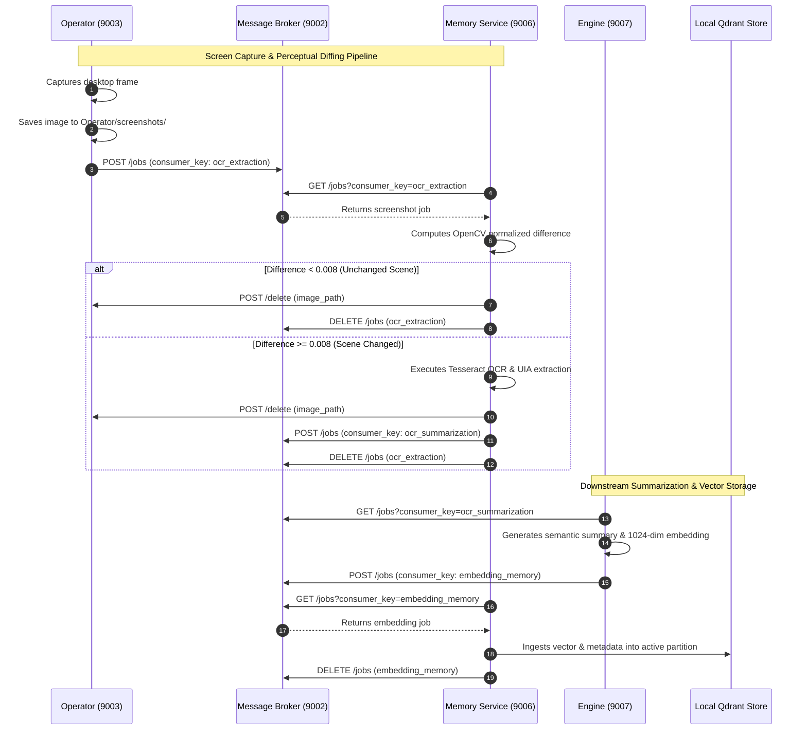

# MIRA Memory Module (Visual Perception & Vector Knowledge Base)

> **The perceptual and recall foundation of MIRA: ingesting screen frames, executing OpenCV difference filtering, performing Tesseract OCR text extraction, and managing local Qdrant vector knowledge bases.**

---

## Table of Contents
- [1. Module Overview](#1-module-overview)
- [2. Module Contents](#2-module-contents)
- [3. How It Communicates](#3-how-it-communicates)
- [4. Technology Stack](#4-technology-stack)
- [5. Architecture Flow Diagram](#5-architecture-flow-diagram)

---

<a id="1-module-overview"></a><a id="module-overview"></a>
## 1. Module Overview

### 1.1 Architectural Purpose
The **Memory** module is the perceptual gateway and digital memory bank of MIRA, operating as a high-throughput computer vision and vector indexing microservice on port **`9006`**. Acting as the eyes and contextual archive of the assistant, it converts raw visual artifacts emitted by the operating system into structured, searchable semantic knowledge. As the native Operator captures desktop frames, Memory consumes these screenshot jobs via Redis Streams, performs matrix-level visual difference analysis using OpenCV to filter out static scenes, extracts textual and accessibility metadata via Tesseract OCR and UI Automation (UIA), and archives the resulting digital activity into a local, high-dimensional vector database managed by **Qdrant**.

In strict adherence to MIRA's **local-first, privacy-by-design** principles, all image processing, optical character recognition, and vector similarity indexing execute locally within the user's physical environment. Sensitive screen contents, code fragments, active browser tabs, and application states are indexed into encrypted Qdrant collections on the machine's local drive without streaming raw imagery to external clouds or third-party storage.

---

### 1.2 Key Capabilities
- **Intelligent Visual Change Detection**: Uses OpenCV matrix subtraction and normalized difference thresholding (`image_diff_threshold: 0.008`) to discard duplicate or idle screen frames, cutting unnecessary OCR compute by over 70%.
- **Structural UI Region Comparison**: Evaluates bounding-box coordinates, element hierarchies, and layout geometry to ignore rapid repetitive noise and identify meaningful UI state transitions.
- **High-Accuracy Optical Character Recognition**: Extracts structured text and layout data from screen frames via multi-threaded Tesseract OCR with adaptive image pre-processing (grayscale conversion, thresholding, contrast normalization).
- **Desktop UI Automation (UIA) Extraction**: Complements visual OCR by inspecting native Accessibility and UI Automation trees (Windows UIA / macOS Accessibility) to capture active window titles, focused control elements, and breadcrumb paths.
- **Local Embedded Qdrant Vector Store**: Manages date-partitioned vector collections (e.g., `kb-24_10_2026-25_10_2026`) indexed with Cosine similarity for sub-millisecond semantic retrieval across past digital workflows.
- **Contextual Semantic Retrieval**: Provides cosine-similarity vector queries filtered by application name (`app_name`), operating system, timestamp bounds, and confidence thresholds to supply the Engine with targeted context.
- **Automated Retention & Storage Lifecycle**: Regularly cleans up temporary screenshot files and provides APIs to purge expired vector collections based on user-configured retention policies.

> [!TIP]
> **Unified Installation & Execution**: To install and run the Memory module alongside the full MIRA ecosystem, see the centralized [Scripts & Installation Guide](../scripts/README.md).

---

<a id="2-module-contents"></a><a id="module-contents"></a>
## 2. Module Contents

### 2.1 Directory & File Manifest
```
Memory/
├── screenshot_processing/             # Computer vision & OCR extraction engine
│   ├── worker.py                      # Async screenshot worker pool & broker job dispatcher
│   ├── data_extractor.py              # OpenCV matrix math, grayscale extraction, & Tesseract OCR
│   ├── image_comparison.py           # Perceptual diffing & Redis-backed frame history comparison
│   ├── region_comparator.py          # UI bounding box & text similarity analysis
│   └── uia_extractor.py               # Native OS Accessibility & UI Automation bridge
├── knowledge_base/                    # Local Qdrant vector database & collection lifecycle
│   ├── worker.py                      # Background worker ingesting embedding jobs into Qdrant
│   ├── qdrant_store.py                # Embedded Qdrant client, schema indexing, & vector search
│   ├── broker_client.py               # Message Broker polling client for 'embedding_memory' stream
│   ├── storage.py                     # Collection discovery, date-range resolution, & disk metrics
│   ├── protection.py                  # Collection retention enforcement & automated pruning
│   ├── encryption.py                  # Optional AES encryption helpers for vector payloads on disk
│   └── config.py                      # Knowledge base batch sizes, collection paths, & defaults
├── app.py                             # FastAPI application entry point, lifecycle, & HTTP routes
├── config.py                          # Service discovery (services.json), Vault sync, & server ports
├── requirements.txt                   # Python package dependencies
└── vault_logger.py                    # Structured logging forwarder to Vault audit logs
```

---

### 2.2 Core Subsystems & Components

#### 1. Visual Perception & Frame Filtering (`screenshot_processing/`)
- **`worker.py` (`ScreenshotExtractionWorkerManager`)**: Orchestrates an asynchronous pool of extraction workers. Continuously polls raw screenshot jobs from the `ocr_extraction` stream in the Message Broker.
- **`image_comparison.py`**: Computes the normalized absolute difference between consecutive grayscale frames using OpenCV (`calculate_image_difference`). If the difference score falls below `0.008`, the frame is flagged as an unchanged scene, the image file is deleted from disk, and OCR compute is bypassed.
- **`region_comparator.py`**: Analyzes bounding box overlap and Levenshtein similarity between UI regions. Prevents rapid consecutive frames (within 4 seconds) with greater than 70% textual overlap from triggering redundant downstream summarization.
- **`data_extractor.py`**: Prepares raw RGB image arrays, applies adaptive thresholding, and invokes Tesseract OCR (`extract_structured_ocr`). Structures extracted text by UI region categories (`header`, `sidebar`, `content`).
- **`uia_extractor.py`**: Interrogates native operating system accessibility trees (Windows UI Automation or macOS AXUIElement) to extract active window titles, tab titles, and focused input fields.

#### 2. Vector Knowledge Base & Recall (`knowledge_base/`)
- **`qdrant_store.py` (`QdrantVectorStore`)**: Wraps an embedded `QdrantClient` operating entirely against the local filesystem (`SYSTEM_STORAGE_PATH/knowledge_base`). Creates collections partitioned by date ranges, indexes 1024-dimensional embedding vectors using Cosine distance, and executes filtered vector search queries.
- **`worker.py` (`KBWorkerManager`)**: Background daemon consuming summarized text chunks and dense embeddings from the `embedding_memory` stream in the Message Broker, batching entries into active Qdrant partitions.
- **`protection.py`**: Implements collection hygiene and retention policies (`Never auto delete`, `7 days`, `30 days`), calculating collection age against UTC timestamps and purging expired physical storage partitions.

---

### 2.3 Frame Deduplication & Data Lifecycle
1. **Operator Capture**: Operator writes an uncompressed frame to `Operator/screenshots/` and posts a job to `ocr_extraction`.
2. **Perceptual Diffing**: Memory reads the frame into a grayscale NumPy matrix and compares it against the previous frame for that specific application.
3. **Instant Deletion of Stale Frames**: If unchanged, Memory calls Operator's `POST /delete` endpoint or unlinks the file locally. Zero disk leaks occur.
4. **OCR & Structured Enrichment**: If visual change is verified, Memory executes Tesseract OCR and Accessibility extraction, packages the text into a structured JSON payload, and publishes it to the `ocr_summarization` stream.
5. **Immediate Cleanup**: The raw screenshot file is permanently deleted from disk immediately after text extraction.

---

<a id="3-how-it-communicates"></a><a id="how-it-communicates"></a>
## 3. How It Communicates

### 3.1 Incoming Endpoints & Ports
The Memory service listens on port **`9006`** and exposes the following HTTP endpoints:

| Method | Endpoint | Description & Usage |
| :--- | :--- | :--- |
| `GET` | `/health` | Health check verifying that the Memory microservice is online (`{"service": "Memory", "status": "online"}`). |
| `GET` | `/status` | Telemetry endpoint reporting worker statuses, active worker counts, knowledge base states, and the current `image_diff_threshold`. |
| `POST` | `/workers/start` | Manually resumes background screenshot extraction workers and knowledge base ingestion workers. |
| `POST` | `/workers/stop` | Manually pauses background screenshot extraction workers and knowledge base ingestion workers. |
| `GET` | `/knowledge-base` | Lists all date-partitioned Qdrant collections with document counts, date ranges, and disk storage metrics. |
| `DELETE`| `/knowledge-base/{name}` | Permanently deletes a specific vector collection partition (e.g. `kb-24_10_2026-25_10_2026`) and its disk files. |
| `POST` | `/knowledge-base/cleanup` | Evaluates system retention policies and deletes all expired knowledge base partitions. |
| `POST` | `/knowledge-base/search` | Executes high-dimensional vector similarity searches with optional filters for `app_name`, `os`, timestamp ranges, and text keywords. |
| `POST` | `/knowledge-base/batch-ingest` | Directly ingests an array of summarized activity records and their vector embeddings into the active Qdrant store. |
| `POST` | `/extract` | Synchronous diagnostic endpoint that extracts raw pixel shapes, grayscale matrices, and OCR text from an image path. |
| `POST` | `/process-job` | Synchronous diagnostic route to trigger full end-to-end extraction processing for an isolated screenshot job payload. |

---

### 3.2 Outgoing Microservice Communication
The Memory service initiates outbound REST requests to three sibling services:

#### 1. Operator Service (Port `9003`)
| Method | Endpoint | Purpose & Usage |
| :--- | :--- | :--- |
| `POST` | `/delete` | Requests immediate hardware-level deletion of a processed screenshot file (`{"image_path": "..."}`) to guarantee zero image storage retention. |

#### 2. Vault Service (Port `9001`)
| Method | Endpoint | Purpose & Usage |
| :--- | :--- | :--- |
| `GET` | `/engine/workers` | Fetches dynamic worker configuration (extraction worker concurrency and polling intervals). |
| `GET` | `/system/storage` | Resolves the verified system storage root path for knowledge base vector persistence. |
| `GET` | `/config/operator` | Ingests capture intervals and knowledge base retention duration settings (`Never auto delete`, etc.). |
| `POST` | `/logs` | Forwards structured diagnostic messages and error traces to Vault's encrypted audit log. |

#### 3. Message Broker Service (Port `9002`)
| Method | Endpoint | Purpose & Usage |
| :--- | :--- | :--- |
| `GET` | `/jobs` | Polls queued jobs from Redis Streams for consumer keys `ocr_extraction` and `embedding_memory`. |
| `DELETE`| `/jobs` | Acknowledges and removes processed jobs from consumer groups `CONSUMER_GROUP_OCR_EXTRACTION` and `CONSUMER_GROUP_EMBEDDING_MEMORY`. |
| `POST` | `/jobs` | Publishes structured OCR text payloads to the `ocr_summarization` stream for downstream Engine summarization. |

---

### 3.3 Message Broker & Redis Streams Integration
Memory acts as both a consumer and producer across Redis Streams:

| Stream / Consumer Key | Role | Consumer Group | Payload Content |
| :--- | :--- | :--- | :--- |
| **`ocr_extraction`** | **Consumer** | `CONSUMER_GROUP_OCR_EXTRACTION` | Raw screenshot job containing `job_id`, `image_path`, `app_name`, `os`, and `timestamp`. |
| **`ocr_summarization`** | **Producer** | `CONSUMER_GROUP_OCR_TEXT_SUMMARIZATION` | Structured OCR output containing `job_id`, `app_name`, `extracted_text`, `ui_regions`, and `timestamp`. |
| **`embedding_memory`** | **Consumer** | `CONSUMER_GROUP_EMBEDDING_MEMORY` | Summarized activity records containing dense embedding vectors (`1024-dim`), ready for Qdrant storage. |

---

<a id="4-technology-stack"></a><a id="technology-stack"></a>
## 4. Technology Stack

| Domain | Technology / Library | Version | Architectural Rationale |
| :--- | :--- | :--- | :--- |
| **API Framework** | **FastAPI** | `^0.110.0` | Asynchronous REST endpoints, native Pydantic validation, and low latency request routing. |
| **ASGI Server** | **Uvicorn** | `^0.28.0` | High-throughput async server handling parallel worker dispatching and health telemetry. |
| **Computer Vision** | **OpenCV (cv2)** | `^4.8.0` | Matrix subtraction, image difference calculation, grayscale conversion, and adaptive thresholding. |
| **Numerical Processing** | **NumPy** | `^1.26.0` | Array manipulation for pixel matrices and bounding box region math. |
| **OCR Engine** | **Tesseract OCR (pytesseract)** | `^0.3.10` | Offline, multi-lingual optical character recognition extracting text from arbitrary desktop frames. |
| **Vector Database** | **Qdrant (Local)** | `^1.9.0` | Embedded local vector database supporting high-dimensional similarity search and payload filtering. |
| **OS Automation** | **pywin32 / UIA** | Platform-specific | Windows UI Automation bridge to extract native active window titles and focused controls. |
| **Data Validation** | **Pydantic v2** | `^2.6.0` | Strict schema validation for vector search queries and batch ingestion payloads. |
| **HTTP Client** | **Requests** | `^2.31.0` | Synchronous REST calls to Message Broker, Operator, and Vault microservices. |

---

<a id="5-architecture-flow-diagram"></a><a id="architecture-flow-diagram"></a>
## 5. Architecture Flow Diagram


