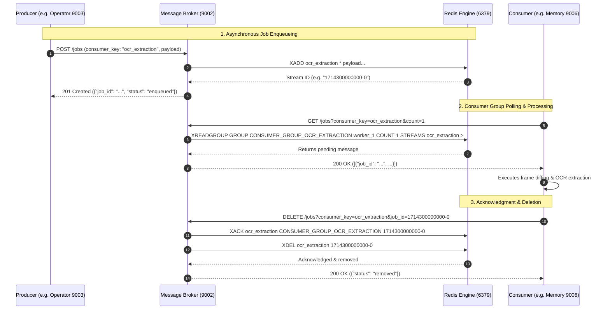

# MIRA Message Broker Module (Asynchronous Event Streaming Hub)

> **The central nervous system of MIRA: orchestrating decoupled event streams, Redis Streams consumer groups, reliable message delivery, and microservice pub/sub routing.**

---

## Table of Contents
- [1. Module Overview](#1-module-overview)
- [2. Module Contents](#2-module-contents)
- [3. How It Communicates](#3-how-it-communicates)
- [4. Technology Stack](#4-technology-stack)
- [5. Architecture Flow Diagram](#5-architecture-flow-diagram)

---

<a id="1-module-overview"></a><a id="module-overview"></a>
## 1. Module Overview

### 1.1 Architectural Purpose
The **Message Broker** module is the central asynchronous communication backbone and event routing microservice of MIRA, running on port **`9002`**. In a distributed desktop AI system where screen capture operates at sub-second intervals and OCR processing demands variable computation time, direct point-to-point HTTP coupling between microservices leads to thread blocking, memory spikes, and dropped events. The Message Broker eliminates tight coupling by wrapping **Redis Streams** behind a unified, high-performance **FastAPI** interface.

Operating as an event-driven intermediary, the Broker provides persistent stream queuing, consumer group partitioning, explicit acknowledgment semantics (`XACK`), and automatic failure recovery. When the native Rust Operator captures a screenshot, it dispatches the job to the Broker and immediately returns to monitoring the display. Downstream consumers—such as Memory's OCR workers and Engine's summarizers—read from dedicated consumer groups at their own processing rate, guaranteeing that temporary spikes in desktop activity never overwhelm system resources.

---

### 1.2 Key Capabilities
- **Decoupled Asynchronous Messaging**: Isolates fast producers (Operator screen capture) from compute-heavy consumers (Memory OCR and Engine summarization) through non-blocking Redis Streams.
- **At-Least-Once Delivery Guarantees**: Employs Redis consumer group acknowledgment semantics (`XREADGROUP`, `XACK`) to ensure no capture job or intelligence event is lost if a worker crashes.
- **Ordered Event Ingestion**: Preserves strict chronological event sequences across desktop activity streams, ensuring that OCR text and context are summarized in true temporal order.
- **Real-Time Consumer Group Telemetry**: Exposes endpoints to monitor pending message counts (PEL), idle times, active consumer worker counts, and queue depth for UI status cards.
- **Queue Administration & Formatting**: Provides programmatic endpoints to flush queues, reset consumer groups, and purge stale entries during maintenance cycles.
- **Transient Memory Caching**: Maintains temporary Redis keys for recent image comparison matrices, active chat states, and ephemeral session buffers.
- **Unified Service Layer Integration**: Acts as the communication bridge allowing the Client, Operator, Memory, Engine, and Vault to interact through standardized REST patterns.

> [!TIP]
> **Unified Installation & Execution**: To install and run the Message Broker alongside the full MIRA ecosystem, see the centralized [Scripts & Installation Guide](../scripts/README.md).

---

<a id="2-module-contents"></a><a id="module-contents"></a>
## 2. Module Contents

### 2.1 Directory & File Manifest
```
Message_Broker/
├── api.py                    # REST route definitions, request validation, & response handlers
├── app.py                    # FastAPI application setup, lifecycle manager, & Uvicorn listener
├── config.py                 # Redis connection parameters, port discovery, & service URLs
├── consumer_group_manager.py # Automated consumer group bootstrapping & offset management
├── consumer_groups.json      # Stream key to consumer group mapping definitions
├── redis_client.py           # Thread-safe Redis connection pool wrapper
├── redis_service.py          # Redis Streams low-level operations (XADD, XREADGROUP, XACK, PEL)
├── requirements.txt          # Python package requirements
└── vault_logger.py           # Logging forwarder reporting broker health to Vault audit logs
```

---

### 2.2 Core Subsystems & Components

#### 1. Redis Streams Service Layer (`redis_service.py`)
- **Job Enqueueing (`XADD`)**: Appends structured JSON payloads into Redis Streams with automatic stream ID generation. Supports stream size trimming (`MAXLEN ~ 10000`) to prevent unbounded RAM growth.
- **Consumer Group Dispatch (`XREADGROUP`)**: Fetches unacknowledged messages for a specific consumer worker, tracking in-flight messages in the Pending Entries List (PEL).
- **Acknowledgment (`XACK`) & Deletion (`XDEL`)**: Confirms successful processing by downstream workers and purges acknowledged message IDs to reclaim Redis memory.
- **Pending Entries Inspector**: Inspects unacknowledged items (`XPENDING`), allowing detection of stuck workers and orphaned jobs.

#### 2. Consumer Group Manager (`consumer_group_manager.py`)
- Reads stream-to-group topologies from `consumer_groups.json`.
- At broker startup, verifies whether the required Redis Streams and Consumer Groups exist. If absent, executes `XGROUP CREATE ... MKSTREAM` with offset `0` or `$` to establish fresh processing pipelines.

#### 3. Image & Chat Cache Controller (`redis_service.py`)
- Provides fast in-memory key-value storage for recent screenshot grayscale comparison matrices (`images/comparison`), enabling Memory to run difference checks without disk I/O.
- Tracks active chat session metadata and real-time streaming buffers.

---

### 2.3 Redis Streams Topology & Consumer Groups
The Message Broker establishes four primary stream pipelines defined in `consumer_groups.json`:

```
[Operator] ──XADD──> ocr_extraction ──────────XREADGROUP──> [Memory Workers]
                                                                  │
                                                          (OCR Extraction)
                                                                  ▼
[Engine]   <──XREADGROUP── ocr_summarization <──XADD─────── [Memory Workers]
   │
 (LLM Summarization & Embeddings)
   ▼
[Engine]   ──XADD──> embedding_memory ────────XREADGROUP──> [Memory KB Workers]
                                                                  │
                                                            (Qdrant Store)
```

| Stream Key | Consumer Group | Producer | Consumer | Payload Data |
| :--- | :--- | :--- | :--- | :--- |
| **`ocr_extraction`** | `CONSUMER_GROUP_OCR_EXTRACTION` | Operator (Port 9003) | Memory (Port 9006) | Screenshot job (`image_path`, `app_name`, `timestamp`) |
| **`ocr_summarization`** | `CONSUMER_GROUP_OCR_TEXT_SUMMARIZATION` | Memory (Port 9006) | Engine (Port 9007) | Extracted screen text and UI region hierarchy |
| **`embedding_memory`** | `CONSUMER_GROUP_EMBEDDING_MEMORY` | Engine (Port 9007) | Memory (Port 9006) | Dense vector embeddings and activity summaries |
| **`config_sync`** | Dynamic Subscriptions | Vault (Port 9001) | Operator / Memory / Engine | Configuration change events triggering hot reloads |

---

<a id="3-how-it-communicates"></a><a id="how-it-communicates"></a>
## 3. How It Communicates

### 3.1 Incoming Endpoints & Ports
The Message Broker listens on port **`9002`** and exposes the following HTTP endpoints:

| Method | Endpoint | Description & Usage |
| :--- | :--- | :--- |
| `GET` | `/health` | Health check verifying broker status and Redis server connectivity (`{"service": "Message Broker", "status": "online"}`). |
| `POST` | `/jobs` | Enqueues a new job into a stream (`consumer_key: ocr_extraction`, `ocr_summarization`, `embedding_memory`, or `config_sync`). |
| `GET` | `/jobs` | Polls pending jobs for a specific consumer group (`?consumer_key=...&count=N`). |
| `DELETE`| `/jobs` | Acknowledges (`XACK`) and deletes a processed job (`?consumer_key=...&job_id=...`). |
| `GET` | `/redis/consumer-groups` | Telemetry endpoint returning queue depth, pending entry counts (PEL), idle times, and active workers across all streams. |
| `DELETE`| `/redis/consumer-groups/{group}` | Drops and destroys an obsolete consumer group from a stream. |
| `POST` | `/redis/clean` | Cleans acknowledged stream entries and flushes idle pending messages. |
| `POST` | `/redis/format` | Administrative factory reset: flushes all MIRA Redis keys and re-initializes consumer groups. |
| `POST` | `/images/comparison` | Stores a grayscale image comparison matrix in Redis for sub-millisecond diff checks. |
| `GET` | `/images/comparison` | Retrieves recent comparison matrices for a given application name. |
| `DELETE`| `/images/comparison` | Purges expired image comparison records. |
| `POST` | `/chat/active` | Registers an active chat session and conversational status in Redis. |
| `GET` | `/chat/active` | Lists all currently active chat sessions. |
| `DELETE`| `/chat/active/{session_id}` | Clears an active chat session entry upon completion. |

---

### 3.2 Outgoing Microservice Communication
The Message Broker forwards diagnostic operational events to the security authority:

#### Vault Service (Port `9001`)
| Method | Endpoint | Purpose & Usage |
| :--- | :--- | :--- |
| `POST` | `/logs` | Dispatches critical operational events, Redis connection drops, and queue telemetry alerts to Vault audit logs. |

---

### 3.3 Redis Server Integration & Persistence
- **Host & Port**: Default connection targets `127.0.0.1:6379` (overridable via `REDIS_HOST` and `REDIS_PORT` environment variables).
- **Connection Pool**: Uses `redis.ConnectionPool` with automatic health checks (`health_check_interval=30`), retry-on-timeout, and connection recycling.
- **Data Persistence**: Uses standard Redis RDB / AOF persistence models. Stream data is ephemeral by design, acting as an in-flight transport pipeline rather than permanent archival storage.

---

<a id="4-technology-stack"></a><a id="technology-stack"></a>
## 4. Technology Stack

| Domain | Technology / Library | Version | Architectural Rationale |
| :--- | :--- | :--- | :--- |
| **API Framework** | **FastAPI** | `^0.110.0` | High-performance asynchronous REST endpoints, route handling, and automatic OpenAPI schema. |
| **ASGI Server** | **Uvicorn** | `^0.28.0` | Asynchronous server powering high concurrent HTTP request dispatching. |
| **Message Engine** | **Redis Streams** | `v6.2+ / v7.x` | Persistent, partitioned, high-throughput append-only stream data structure with consumer groups. |
| **Redis Driver** | **redis-py** | `^5.0.0` | Official thread-safe Redis client supporting connection pooling, stream commands (`XADD`, `XREADGROUP`, `XACK`), and PEL inspection. |
| **Data Validation** | **Pydantic v2** | `^2.6.0` | Strict typing and validation for job enqueue payloads, consumer query parameters, and telemetry metrics. |
| **HTTP Client** | **Requests** | `^2.31.0` | Synchronous outbound HTTP client communicating diagnostic alerts to Vault. |

---

<a id="5-architecture-flow-diagram"></a><a id="architecture-flow-diagram"></a>
## 5. Architecture Flow Diagram


