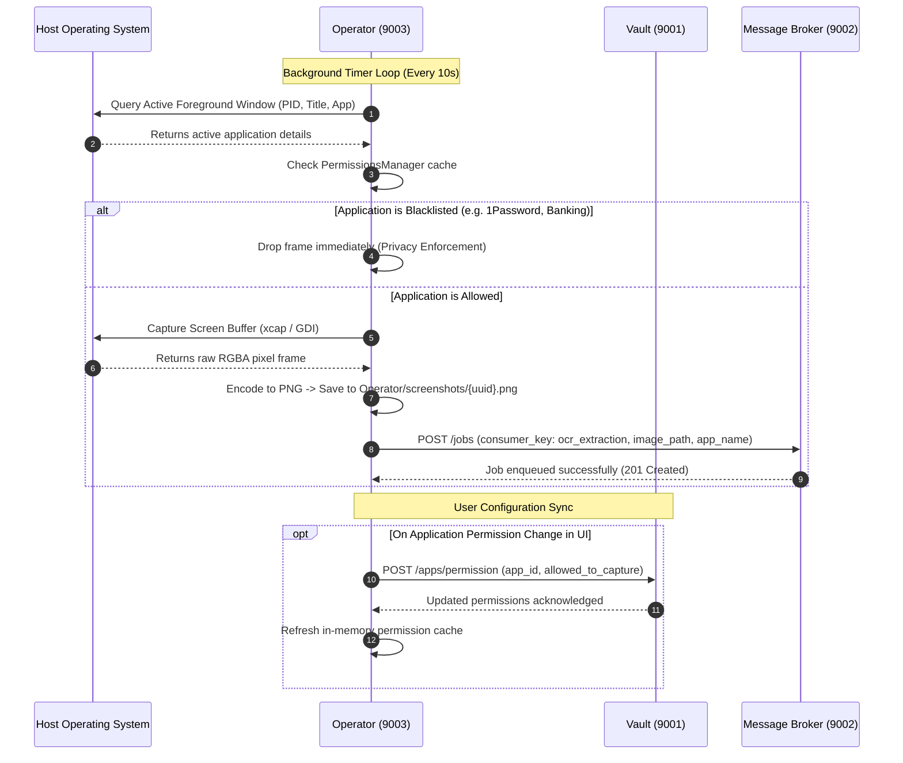

# MIRA Operator Module (Native OS Capture & System Automation)

> **The high-performance, native Rust system operator of MIRA: executing low-latency screen captures, enforcing per-application capture permissions, tracking active windows, and bridging OS activity with Message Broker queues.**

---

## Table of Contents
- [1. Module Overview](#1-module-overview)
- [2. Module Contents](#2-module-contents)
- [3. How It Communicates](#3-how-it-communicates)
- [4. Technology Stack](#4-technology-stack)
- [5. Architecture Flow Diagram](#5-architecture-flow-diagram)

---

<a id="1-module-overview"></a><a id="module-overview"></a>
## 1. Module Overview

### 1.1 Architectural Purpose
The **Operator** module is the native low-level bridge between MIRA and the host operating system. Written from the ground up in **Rust** using the **Tokio** asynchronous runtime and the **Axum** web framework, it executes as a lightweight, lightning-fast microservice on port **`9003`**. The Operator is engineered for high-throughput, non-intrusive desktop monitoring: it captures multi-monitor screen buffers using hardware-accelerated APIs (`xcap` and native Windows GDI/DirectX subsystems), inspects active foreground processes, enforces strict user-defined application privacy boundaries, and dispatches capture jobs asynchronously to the Message Broker.

Because the Operator runs directly against the operating system's native windowing APIs, it achieves sub-10ms capture speeds with negligible CPU and RAM utilization. It serves as the primary enforcement point for user privacy: if a user marks an application (such as a password manager, banking portal, or private communication client) as restricted, the Operator drops the frame before it is ever written to disk or transmitted to the OCR pipeline.

---

### 1.2 Key Capabilities
- **Ultra-Low Overhead Screen Capture**: Captures full-resolution desktop displays at configurable cadences (`CAPTURE_INTERVAL_SECS`, default: 10s) using native Rust bindings (`xcap`), avoiding heavy Electron or Python capture dependencies.
- **Active Window & Process Inspection**: Detects the active foreground executable, window title, and process ID in real time using native OS APIs (`windows-sys` on Windows; CoreGraphics / Accessibility on macOS; X11 / Wayland on Linux).
- **Per-Application Permission Guard**: Checks the active foreground process against permission rules stored in Vault. If an application is blacklisted, screen capture is immediately skipped to guarantee complete privacy.
- **Automated System App Discovery**: Scans installed operating system applications, normalizes icon paths and executable metadata, and synchronizes the application registry with Vault.
- **Microphone State & Automation Control**: Manages the host system microphone capture flag, auto-start toggles, and status reporting for UI widgets.
- **Asynchronous Redis Stream Dispatch**: Compresses captured frames to PNG format and dispatches structured metadata (`job_id`, `app_name`, `image_path`) directly to Message Broker's `ocr_extraction` stream.
- **Secure Screenshot Unlinking**: Exposes secure REST endpoints to delete local screenshot files immediately after downstream processing, guaranteeing zero persistent image artifacts.

> [!TIP]
> **Unified Installation & Execution**: To install and run the Operator alongside the full MIRA ecosystem, see the centralized [Scripts & Installation Guide](../scripts/README.md).

---

<a id="2-module-contents"></a><a id="module-contents"></a>
## 2. Module Contents

### 2.1 Directory & File Manifest
```
Operator/
├── src/
│   ├── main.rs                   # Process entry point, service bootstrapping, & Axum listener
│   ├── api.rs                    # REST route definitions, request handlers, & state extraction
│   ├── capture.rs                # Native screen capture logic (xcap, GDI, multi-monitor)
│   ├── flow.rs                   # CaptureManager loop, timer scheduler, & capture lifecycle
│   ├── permissions.rs            # Application blacklist/whitelist verification & cache
│   ├── app_discovery.rs          # Cross-platform installed application scanning & icon resolution
│   ├── broker_client.rs          # HTTP client publishing capture jobs to Message Broker
│   ├── microphone.rs             # Microphone hardware capture state & auto-start manager
│   ├── local_state.rs            # Persisted local capture interval & execution state
│   ├── config.rs                 # Dynamic service discovery (services.json) & Vault sync
│   └── vault_logger.rs           # Asynchronous logger dispatching audit events to Vault
├── screenshots/                  # Ephemeral directory for in-flight captured PNG frames
├── operator_state.json           # Cached local interval and runtime configuration
├── Cargo.toml                    # Rust crate definition and dependencies
└── Cargo.lock                    # Locked dependency graph
```

---

### 2.2 Core Subsystems & Components

#### 1. Capture Lifecycle & Scheduler (`flow.rs` & `capture.rs`)
- **`CaptureManager`**: Houses the asynchronous loop running on Tokio. Sleeps for the configured `capture_interval_secs` duration, then queries the active foreground window.
- **`capture_screen`**: Uses `xcap::Monitor` to retrieve the active screen's raw pixel buffer. On Windows, falls back to GDI/DirectX handles (`windows-sys`) to bypass hardware-acceleration black screens. Saves the frame as a PNG file into `Operator/screenshots/` with a unique UUID.

#### 2. Process & Permission Guard (`permissions.rs`)
- Interrogates the operating system's window manager to identify the currently focused application (`app_name` and `window_title`).
- Consults the in-memory `PermissionsManager` populated from Vault. If `allowed_to_capture == false`, the capture loop logs a privacy bypass and immediately aborts the cycle without saving any imagery to disk.

#### 3. Application Discovery Engine (`app_discovery.rs`)
- Scans system registries and directories (`/Applications` and `~/Applications` on macOS; `Program Files` and `HKLM/HKCU Uninstall` registry keys on Windows; `/usr/share/applications` on Linux).
- Parses application manifests (`Info.plist`, `.desktop` files, `.exe` metadata) to compile an exhaustive registry of installed software, which is pushed to Vault via `POST /apps/refresh`.

#### 4. Hardware Microphone Controller (`microphone.rs`)
- Tracks the enabled/disabled state of acoustic audio capture across MIRA. Exposes status querying and auto-start toggling endpoints consumed by the Client.

---

### 2.3 Application Blacklisting & Privacy Protection
```
[Capture Tick] ──> [Detect Foreground App] ──> [Query PermissionsManager]
                                                         │
                     ┌───────────────────────────────────┴───────────────────────────────────┐
                     ▼                                                                       ▼
             [App is Whitelisted]                                                    [App is Blacklisted]
                     │                                                                       │
           [Capture Frame to PNG]                                                    [Abort Capture Cycle]
                     │                                                                       │
     [POST /jobs (ocr_extraction)]                                                   [Zero Bytes Stored]
```

---

<a id="3-how-it-communicates"></a><a id="how-it-communicates"></a>
## 3. How It Communicates

### 3.1 Incoming Endpoints & Ports
The Operator service runs natively on port **`9003`** and exposes the following HTTP endpoints:

| Method | Endpoint | Description & Usage |
| :--- | :--- | :--- |
| `GET` | `/health` | Health check verifying Operator microservice uptime (`{"service": "Operator", "status": "online"}`). |
| `GET` | `/status` | Returns active capture loop state (`is_running`), current capture interval, foreground application, and capture counter. |
| `POST` | `/start` | Starts or resumes the background screen capture timer loop. |
| `POST` | `/stop` | Pauses the background screen capture timer loop. |
| `POST` | `/interval` | Updates the capture cadence (`{"capture_interval_secs": 15}`). Persists changes to Vault and local state. |
| `POST` | `/delete` | Securely unlinks and removes an ephemeral screenshot file from disk (`{"image_path": "..."}`). Called by Memory after OCR processing. |
| `GET` | `/apps` | Lists all discovered system applications along with their capture permission status (`allowed_to_capture: true/false`). |
| `POST` | `/apps/refresh` | Forces a full re-scan of installed system applications and synchronizes the list with Vault. |
| `POST` | `/apps/permission` | Updates the capture permission for a specific application ID (`{"app_id": "...", "allowed_to_capture": false}`). |
| `GET` | `/microphone/status` | Queries the global microphone recording state (`{"is_recording": true/false}`). |
| `POST` | `/microphone/start` | Signals the system that microphone audio capture is active. |
| `POST` | `/microphone/stop` | Signals the system that microphone audio capture is suspended. |
| `GET` | `/microphone/auto-start` | Checks if microphone auto-start is enabled upon system boot. |
| `POST` | `/microphone/auto-start` | Updates the microphone auto-start preference. |

---

### 3.2 Outgoing Microservice Communication
The Operator service initiates outbound HTTP calls to two sibling services:

#### 1. Vault Service (Port `9001`)
| Method | Endpoint | Purpose & Usage |
| :--- | :--- | :--- |
| `GET` | `/config/operator` | Ingests initial capture intervals, auto-start flags, and retention periods at startup. |
| `POST` | `/config/operator` | Persists user-modified capture intervals (`capture_interval_secs`). |
| `GET` | `/apps` | Retrieves user-defined application whitelist and blacklist permission rules. |
| `POST` | `/apps/permission` | Propagates individual application permission overrides to Vault. |
| `POST` | `/logs` | Forwards operational audit logs, capture event counts, and privacy drops. |

#### 2. Message Broker Service (Port `9002`)
| Method | Endpoint | Purpose & Usage |
| :--- | :--- | :--- |
| `POST` | `/jobs` | Dispatches captured screenshot payloads to the `ocr_extraction` stream (`job_id`, `app_name`, `image_path`, `os`, `timestamp`). |

---

### 3.3 Message Broker & Redis Streams Integration
Operator functions exclusively as a **Producer** in the Message Broker architecture:

| Stream / Consumer Key | Role | Payload Fields | Downstream Consumer |
| :--- | :--- | :--- | :--- |
| **`ocr_extraction`** | **Producer** | `job_id`: UUIDv4<br>`app_name`: String<br>`image_path`: Absolute file path<br>`os`: Platform identifier<br>`timestamp`: Unix epoch | **Memory Service** (`CONSUMER_GROUP_OCR_EXTRACTION`) |

---

<a id="4-technology-stack"></a><a id="technology-stack"></a>
## 4. Technology Stack

| Domain | Technology / Library | Version | Architectural Rationale |
| :--- | :--- | :--- | :--- |
| **Language** | **Rust (Edition 2021)** | `1.75+` | Memory safety, zero-cost abstractions, deterministic performance, and sub-10ms capture cycles. |
| **Async Runtime** | **Tokio** | `1.38` | Multi-threaded asynchronous runtime driving non-blocking HTTP and capture timer loops. |
| **Web Framework** | **Axum** | `0.7.5` | Ergonomic, blazingly fast web framework built directly on Tokio and Tower. |
| **Screen Capture** | **xcap** | `0.6.1` | Native, cross-platform display and window capture library. |
| **Windows Win32** | **windows-sys** | `0.52.0` | Direct Win32 GDI, DWM, and DPI-aware windowing handles for seamless Windows capture. |
| **Image Encoding** | **image** | `0.25.1` | High-speed PNG compression and memory buffer encoding. |
| **Serialization** | **Serde & Serde JSON** | `1.0.204` | Zero-copy JSON serialization for REST payloads and Redis stream messages. |
| **HTTP Client** | **reqwest** | `0.12.5` | Asynchronous connection-pooled HTTP client communicating with Vault and Message Broker. |
| **Tracing & Logs** | **tracing / tracing-subscriber** | `0.1.40` | Structured, contextual diagnostic logging with ANSI formatting and log level filtering. |

---

<a id="5-architecture-flow-diagram"></a><a id="architecture-flow-diagram"></a>
## 5. Architecture Flow Diagram


