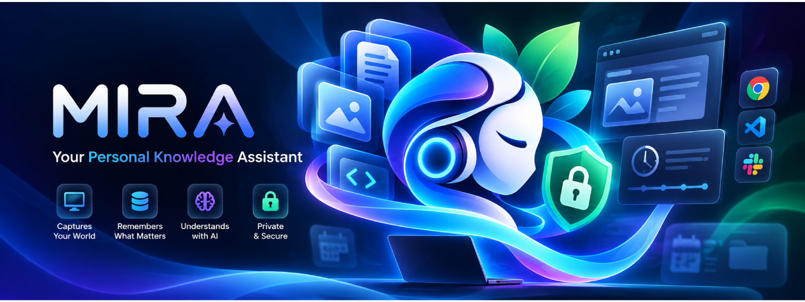
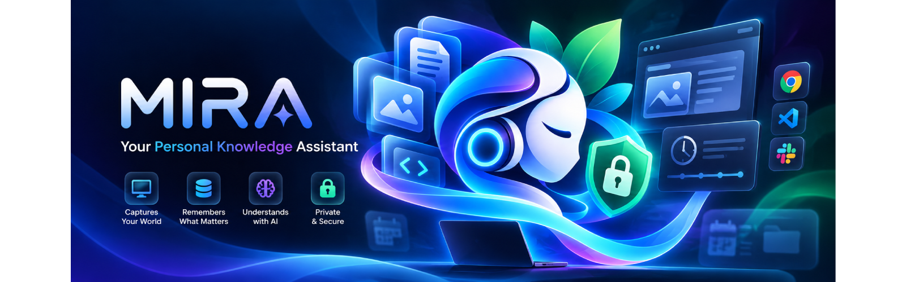
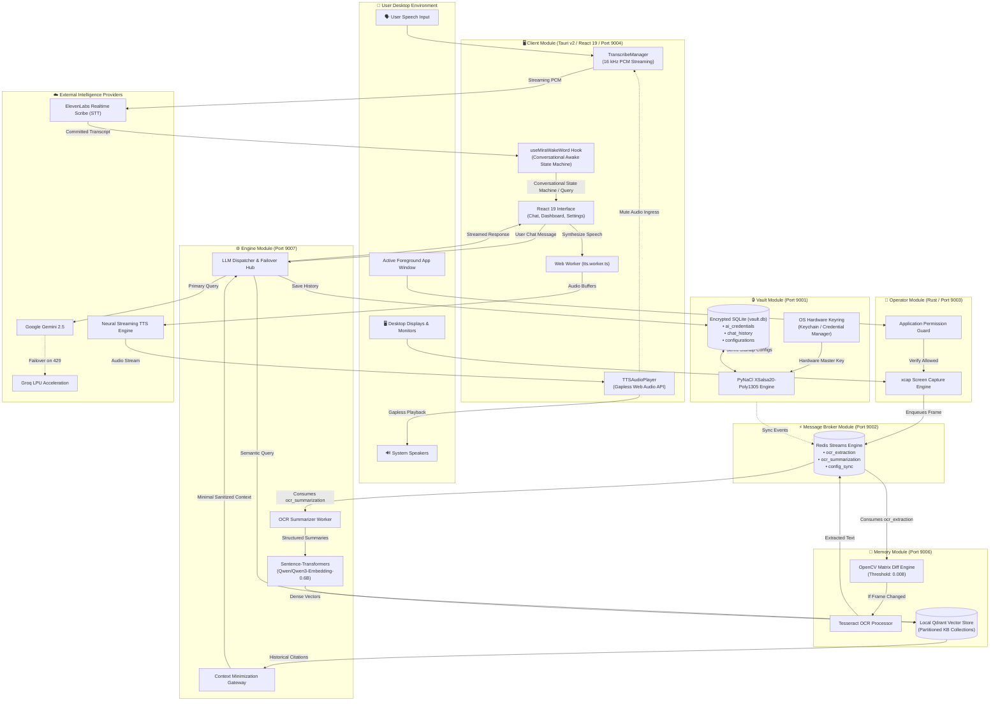

<p align="center">
  
</p>

<h1 align="center">MIRA</h1>
<p align="center"><strong>Memory • Intelligence • Recall • Assistant</strong></p>

<p align="center">
  <em>An autonomous, context-aware, privacy-first personal AI operating system and digital memory that anticipates your needs, organizes your workflow, and keeps your private data strictly on your local machine.</em>
</p>

<p align="center">
  
  
  
  
  
  
  
  <a href="SECURITY.md"></a>
</p>

<p align="center">
  <a href="KNOWLEDGE_BASE.md"><strong>📖 Read the Complete MIRA Knowledge Base & Architecture Manual →</strong></a>
  <br />
  <a href="SECURITY.md"><strong>🛡️ Read the Security & Vulnerability Policy (SECURITY.md) →</strong></a>
</p>

> [!NOTE]
> **Master Knowledge Base & Security Policy**: For an exhaustive, systematic reference guide detailing every microservice, port mapping, data pipeline, and cryptographic model in MIRA, read the **[MIRA Knowledge Base (KNOWLEDGE_BASE.md)](KNOWLEDGE_BASE.md)**. For vulnerability reporting, cryptographic specifications, and privacy guarantees, refer to our **[Security Policy (SECURITY.md)](SECURITY.md)**.

---

## Table of Contents
- [1. What Is MIRA?](#1-what-is-mira)
- [2. Privacy-First Architecture & Guarantees](#2-privacy-first-architecture--guarantees)
- [3. Core Feature Matrix](#3-core-feature-matrix)
- [4. Module Navigation & Subsystem Deep Dives](#4-module-navigation--subsystem-deep-dives)
  - [4.1 Client Module (Desktop UI & Conversational Voice)](#41-client-module-desktop-ui--conversational-voice)
  - [4.2 Engine Module (LLM Reasoning & Orchestration)](#42-engine-module-llm-reasoning--orchestration)
  - [4.3 Memory Module (Perception, OCR & Qdrant Vectors)](#43-memory-module-perception-ocr--qdrant-vectors)
  - [4.4 Operator Module (Native Rust Screen Capture)](#44-operator-module-native-rust-screen-capture)
  - [4.5 Vault Module (Encrypted Configuration & Secrets)](#45-vault-module-encrypted-configuration--secrets)
  - [4.6 Message Broker Module (Redis Streams Event Backbone)](#46-message-broker-module-redis-streams-event-backbone)
  - [4.7 Scripts & Orchestration Toolkit (Unified Starter & Builder)](#47-scripts--orchestration-toolkit-unified-starter--builder)
- [5. Quickstart & Launching MIRA](#5-quickstart--launching-mira)
- [6. Technology Stack Matrix](#6-technology-stack-matrix)
- [7. Future Scope & Roadmap](#7-future-scope--roadmap)
- [8. Master System Architecture & Flow Diagram](#8-master-system-architecture--flow-diagram)
- [9. License & Contributing](#9-license--contributing)

---

<a id="1-what-is-mira"></a>
## 1. What Is MIRA?

<a id="11-the-philosophy-of-a-local-first-personal-os"></a>
### 1.1 The Philosophy of a Local-First Personal OS
Traditional virtual assistants wait passively for explicit typed prompts, retain little to no persistent context regarding your actual desktop workflow, and frequently transmit raw screen captures, keystrokes, and documents to cloud data centers for centralized training.

**MIRA** reimagines the human-computer relationship. Operating as an autonomous, decentralized personal digital memory and ambient assistant, MIRA continuously captures your digital footprint—browsing sessions, code edits, reading materials, terminal outputs, and design projects—builds an encrypted, local semantic knowledge base, and uses intelligent background workers to anticipate your needs throughout the day. 

MIRA operates seamlessly across two distinct operational paradigms:
1. **Reactive Assistance**: Instant, contextual recall of past activities, documents, decisions, and system queries issued via keyboard or natural ambient speech commands.
2. **Proactive Intelligence**: Prepares structured daily agendas, personalized morning news briefs, relevant technical roadmaps, and project continuation summaries before you even ask.

---

<a id="12-the-four-pillars-memory-intelligence-recall-assistant"></a>
### 1.2 The Four Pillars: Memory, Intelligence, Recall, Assistant

| Pillar | Architectural Role | Technical Implementation |
| :--- | :--- | :--- |
| **🧠 Memory** | Continuous Digital Perception | Low-overhead screen capture (`xcap`), OpenCV matrix diffing, multi-threaded Tesseract OCR, and Windows UI Automation metadata extraction. |
| **⚡ Intelligence** | Hybrid Local/Cloud Reasoning | Multi-provider LLM orchestration (Google Gemini & Groq LPU) with dynamic failover, prompt minimization, and background activity summarization. |
| **🔍 Recall** | Natural Language Work Search | Dense vector embeddings (`Qwen/Qwen3-Embedding-0.6B`) stored in local Qdrant collections for sub-millisecond semantic search. |
| **🤖 Assistant** | Ambient Voice & Desktop Control | Bidirectional streaming voice with a conversational awake follow-up window, gapless Web Audio synthesis, and native OS automation. |

---

<a id="2-privacy-first-architecture--guarantees"></a><a id="2-privacy-first-architecture-guarantees"></a>
## 2. Privacy-First Architecture & Guarantees

<p align="center">
  
</p>

> [!TIP]
> **Formal Security & Vulnerability Policy**: For our coordinated disclosure procedure, response SLA, hardware-backed keyring derivations, and cryptographic guarantees, see **[SECURITY.md](SECURITY.md)**.

<a id="21-local-first-zero-data-harvesting-policy"></a>
### 2.1 Local-First Zero Data Harvesting Policy
- **No Cloud Data Collection**: Because MIRA is built from the ground up as a strictly local-first operating assistant, **we do not capture, harvest, collect, or store your personal data, screen captures, or voice recordings in the cloud**.
- **Zero Profiling & Model Training**: Your conversations, work habits, code edits, and documents are never collected for advertising, tracking, telemetry, or centralized AI model training.
- **Physical Machine Sovereignty**: Your raw activity logs, optical character recognition outputs, local databases, and Qdrant vector indexes live solely on your physical drive under your direct control.
- **Encrypted Local Storage**: Stored data is sealed with authenticated ciphers and locked using host OS hardware keyrings. Nobody else—including the developers of MIRA—can view, intercept, or harvest your private data.

<a id="22-context-minimization-gateway"></a>
### 2.2 Context Minimization Gateway
MIRA enforces a strict architectural boundary between **private storage** and **intelligence inference**:
- **Zero Full-Database Uploads**: MIRA never streams raw screenshots, entire databases, or full activity timelines to cloud LLMs.
- **Precision Extraction**: When answering a query, the Engine retrieves only the single most relevant 2-3 sentence semantic snippet from local Qdrant memory.
- **Anonymization**: PII (Personally Identifiable Information), passwords, and extraneous desktop coordinates are scrubbed prior to dispatching prompts to external LLM providers.

<a id="23-hardware-backed-key-derivation--zero-knowledge-storage"></a><a id="23-hardware-backed-key-derivation-zero-knowledge-storage"></a>
### 2.3 Hardware-Backed Key Derivation & Zero-Knowledge Storage
- Persistent configurations, chat logs, user profile details, and API credentials are encrypted with authenticated symmetric cryptography (**PyNaCl SecretBox / XSalsa20-Poly1305**).
- The 32-byte master encryption key is derived directly from the host operating system's native hardware-backed credential store (**Apple Keychain** on macOS, **Windows Credential Manager** on Windows, and **SecretService / GNOME Keyring** on Linux).
- Even if the machine's SQLite database file (`vault.db`) is physically extracted, it cannot be decrypted without the host machine's hardware-bound keyring session.

<a id="24-application-blacklisting--screen-boundaries"></a><a id="24-application-blacklisting-screen-boundaries"></a>
### 2.4 Application Blacklisting & Screen Boundaries
- Users can selectively blacklist sensitive applications (such as 1Password, Bitwarden, banking portals, or private messaging clients) from the Client Settings dashboard.
- The native Rust Operator inspects the active foreground process *before* triggering capture: blacklisted applications are immediately dropped from memory and never written to disk or sent to the OCR pipeline.

<a id="25-transient-audio--strict-memory-hygiene"></a><a id="25-transient-audio-strict-memory-hygiene"></a>
### 2.5 Transient Audio & Strict Memory Hygiene
- Ambient microphone audio buffers are streamed directly into volatile RAM for WebSocket transcription and are immediately wiped upon processing.
- Raw PCM and WAV audio is never persisted to disk.
- All temporary screenshot PNG files are automatically unlinked and permanently deleted once OCR matrix analysis concludes.

---

<a id="3-core-feature-matrix"></a>
## 3. Core Feature Matrix

- 🎙️ **Ambient Voice Interface & Conversational Awake State Machine**:
  - Real-time speech-to-text powered by ElevenLabs Realtime Scribe WebSocket.
  - Automatic wake-word detection (*"Mira"*, *"Meera"*, etc.) with clean query extraction.
  - Conversational awake follow-up window: reply naturally without repeating *"Mira"*.
  - Continuous multi-turn dialogue within the same chat session, with automatic silence timeout back to idle standby.
  - Gapless Web Audio API scheduler delivering seamless, stutter-free "single-stroke" speech playback.
- 🌅 **Proactive Executive Briefings**:
  - Automatically generates an organized morning agenda based on unfinished project items.
  - Curates personalized news summaries matching user-defined technical interests.
  - Delivers localized weather forecasts without cloud tracking.
- 📸 **Native Rust System Operator**:
  - Sub-10ms multi-monitor screen captures using `xcap` and native OS GDI/DirectX APIs.
  - Foreground process and window title tracking with zero perceptible system latency.
- 👁️ **Visual Perception & Deduplication**:
  - OpenCV matrix subtraction discards static, unchanged screen frames (threshold: `0.008`), cutting downstream compute by over 70%.
  - Multi-threaded Tesseract OCR pre-processing and Windows UI Automation metadata extraction.
- 📚 **Local Qdrant Vector Knowledge Base**:
  - Dense semantic vector embeddings generated by local PyTorch models (`Qwen/Qwen3-Embedding-0.6B`).
  - Partitioned daily collections with automated retention cleanup.
- 🛡️ **Zero-Trust Encrypted Vault**:
  - Authenticated encryption (XSalsa20-Poly1305) backed by OS hardware keychains.
  - Encrypted multi-session chat histories, user profiles, and audit log tracking.
- ⚡ **Redis Streams Messaging Backbone**:
  - High-throughput asynchronous event streams (`ocr_extraction`, `ocr_summarization`, `config_sync`).
  - Consumer groups with explicit acknowledgment (`XACK`) and at-least-once delivery semantics.

---

<a id="4-module-navigation--subsystem-deep-dives"></a><a id="4-module-navigation-subsystem-deep-dives"></a>
## 4. Module Navigation & Subsystem Deep Dives

MIRA is structured as an event-driven microservices architecture. Each module maintains its own dedicated documentation:

```
Mira/
├── Client/            # Port 9004: Desktop GUI, Ambient Voice Engine, Zustand Store
├── Engine/            # Port 9007: LLM Orchestrator, Multi-Turn Chat, Context Minimizer
├── Memory/            # Port 9006: OpenCV Frame Diffing, Tesseract OCR, Qdrant Vectors
├── Operator/          # Port 9003: Native Rust Screen Capture & App Permission Guard
├── Vault/             # Port 9001: Encrypted Secrets, Hardware Keyring, Audit Logs
├── Message_Broker/    # Port 9002: Redis Streams Backbone & Event Queuing
├── scripts/           # Unified Lifecyle Manager (start.py) & Build Orchestrator (build.py)
└── utils/             # Transcribe logs & shared schemas
```

<a id="41-client-module-desktop-ui--conversational-voice"></a><a id="41-client-module-desktop-ui-conversational-voice"></a>
### [4.1 Client Module (Desktop UI & Conversational Voice)](Client/README.md)
* **Path**: [`Client/README.md`](Client/README.md)
* **Tech Stack**: Tauri v2, React 19, TypeScript, TailwindCSS v4, Vite, Web Audio API, Web Workers
* **Primary Role**: Native cross-platform desktop application host, multi-session chat dashboard, real-time speech-to-text WebSocket client, conversational awake state machine, and gapless voice synthesis scheduler.

<a id="42-engine-module-llm-reasoning--orchestration"></a><a id="42-engine-module-llm-reasoning-orchestration"></a>
### [4.2 Engine Module (LLM Reasoning & Orchestration)](Engine/README.md)
* **Path**: [`Engine/README.md`](Engine/README.md)
* **Tech Stack**: Python 3.11, FastAPI, Uvicorn, LangGraph, Google GenAI SDK, Groq LPU SDK, PyTorch
* **Primary Role**: Central AI reasoning authority, multi-turn chat WebSocket streaming (`/ws/chat`), provider failover (Gemini $\to$ Groq), screen OCR summarization worker, and dense vector embeddings (`Qwen/Qwen3-Embedding-0.6B`).

<a id="43-memory-module-perception-ocr--qdrant-vectors"></a><a id="43-memory-module-perception-ocr-qdrant-vectors"></a>
### [4.3 Memory Module (Perception, OCR & Qdrant Vectors)](Memory/README.md)
* **Path**: [`Memory/README.md`](Memory/README.md)
* **Tech Stack**: Python 3.11, FastAPI, OpenCV, NumPy, Tesseract OCR, Qdrant Client, UI Automation
* **Primary Role**: Consumes screenshot jobs, performs matrix difference thresholding (`image_diff_threshold: 0.008`) to discard static frames, extracts text via Tesseract OCR, and manages local partitioned Qdrant vector knowledge base collections.

<a id="44-operator-module-native-rust-screen-capture"></a>
### [4.4 Operator Module (Native Rust Screen Capture)](Operator/README.md)
* **Path**: [`Operator/README.md`](Operator/README.md)
* **Tech Stack**: Rust (2021 Edition), Tokio, Axum, `xcap`, `image`, `windows-sys`
* **Primary Role**: Ultra-fast, low-overhead native screen capture, active window/executable tracking, per-application privacy boundary enforcement, system application discovery, and asynchronous job dispatch to Message Broker.

<a id="45-vault-module-encrypted-configuration--secrets"></a><a id="45-vault-module-encrypted-configuration-secrets"></a>
### [4.5 Vault Module (Encrypted Configuration & Secrets)](Vault/README.md)
* **Path**: [`Vault/README.md`](Vault/README.md)
* **Tech Stack**: Python 3.11, FastAPI, SQLite, PyNaCl (SecretBox / libsodium), OS Keyring
* **Primary Role**: Central security and configuration authority, hardware-backed master key derivation (Keychain / Credential Manager), authenticated encryption for AI credentials, multi-session chat persistence, and encrypted audit logging.

<a id="46-message-broker-module-redis-streams-event-backbone"></a>
### [4.6 Message Broker Module (Redis Streams Event Backbone)](Message_Broker/README.md)
* **Path**: [`Message_Broker/README.md`](Message_Broker/README.md)
* **Tech Stack**: Python 3.11, FastAPI, Redis Streams, `redis-py`
* **Primary Role**: High-performance asynchronous communication backbone, decoupled topic streams (`ocr_extraction`, `ocr_summarization`, `config_sync`), consumer group routing with acknowledgment semantics (`XACK`), and queue telemetry.

<a id="47-scripts--orchestration-toolkit-unified-starter--builder"></a><a id="47-scripts-orchestration-toolkit-unified-starter-builder"></a>
### [4.7 Scripts & Orchestration Toolkit (Unified Starter & Builder)](scripts/README.md)
* **Path**: [`scripts/README.md`](scripts/README.md)
* **Tech Stack**: Python 3.11, `psutil`, `socket`, `subprocess`, Tauri CLI, Vite, Cargo
* **Primary Role**: Master multi-service lifecycle orchestrator (`start.py`), dynamic port conflict resolver (`services.json`), cross-platform compilation & native installer packager (`build.py`), and unified installation engine.

---

<a id="5-how-to-install--run-every-device--os"></a><a id="5-quickstart--launching-mira"></a>
## 5. Quickstart & Launching MIRA

<p align="center">
  
</p>

### 5.1 System Prerequisites
Before launching MIRA, ensure the following core runtimes are installed on your machine:
- **Python**: `3.10` - `3.12` (`3.11` recommended)
- **Node.js**: `v18.x` or `v20.x` LTS & `npm`
- **Rust Toolchain**: Stable channel (`rustc` & `cargo` `1.75+`)
- **Redis Server**: `v6.2+` (running on `127.0.0.1:6379`)
- **Tesseract OCR**: Installed and reachable in your system PATH

---

### 5.2 One-Click Unified Starter (`start.py`)

MIRA includes an intelligent root lifecycle supervisor (`scripts/start.py`) that checks dependencies, dynamically detects and resolves port conflicts, configures service discovery, boots all background microservices in strict dependency order, and monitors live health metrics:

```bash
# Clone the repository
git clone https://github.com/DhirajKarangale/Mira.git
cd Mira

# Launch all microservices simultaneously:
python scripts/start.py
```

Upon boot, the orchestrator reports real-time socket allocations and status:
```text
==================================================================================
Module             Default Port   Assigned Port   Assigned Base URL            Status    
==================================================================================
Vault              9001           9001            http://127.0.0.1:9001        OK (DEFAULT)
Message Broker     9002           9002            http://127.0.0.1:9002        OK (DEFAULT)
Operator           9003           9003            http://127.0.0.1:9003        OK (DEFAULT)
Client (Vite/Web)  9004           9004            http://127.0.0.1:9004        OK (DEFAULT)
Memory             9006           9006            http://127.0.0.1:9006        OK (DEFAULT)
Engine             9007           9007            http://127.0.0.1:9007        OK (DEFAULT)
==================================================================================
```

Open **`http://localhost:9004`** in your browser (or view the native Tauri window) to start interacting with MIRA!

> [!TIP]
> **Advanced OS Compilations & Native Installers**: For manual step-by-step per-OS environment setups (macOS Homebrew, Windows Winget, Ubuntu/Debian apt), building native standalone `.exe`, `.dmg`, or `.AppImage` installers via Tauri v2, or customizing `services.json`, refer to **[scripts/README.md](scripts/README.md)** and the **[Master Knowledge Base (KNOWLEDGE_BASE.md)](KNOWLEDGE_BASE.md)**.


---

<a id="6-technology-stack-matrix"></a>
## 6. Technology Stack Matrix

| Domain | Technology / Library | Purpose / Role |
| :--- | :--- | :--- |
| **Desktop Host** | [Tauri v2](https://v2.tauri.app/) | Ultra-lean native desktop application container using OS WebViews |
| **User Interface** | [React 19](https://react.dev/), [TailwindCSS v4](https://tailwindcss.com/) | Modern reactive dashboard, dark mode glassmorphism, responsive chat |
| **Frontend State** | [Zustand](https://github.com/pmndrs/zustand) | Minimalist reactive state management with selective cache hydration |
| **Speech-to-Text** | ElevenLabs Realtime Scribe | Sub-250ms streaming Speech-to-Text WebSocket with VAD |
| **Text-to-Speech** | Neural Audio Synthesis | Ultra-low latency neural streaming voice synthesis |
| **Audio Hardware** | Web Audio API | Hardware-timed gapless FIFO buffer scheduling for one-stroke speech |
| **System Capture** | [Rust](https://www.rust-lang.org/) (`xcap`, `tokio`, `axum`) | Sub-10ms multi-display screen capture and active window privacy guard |
| **Event Streaming**| [Redis Streams](https://redis.io/) | High-throughput asynchronous message broker with consumer groups |
| **AI Orchestration**| [FastAPI](https://fastapi.tiangolo.com/), [LangGraph](https://langchain-ai.github.io/langgraph/) | Agentic workflows, context minimization, and provider failover |
| **LLM Inference** | Google Gemini 2.5 & Groq LPU | Hybrid multi-model cloud reasoning with automatic quota failover |
| **Local Embeddings**| PyTorch & Sentence-Transformers | Dense vector representations generated locally (`Qwen/Qwen3-Embedding-0.6B`)|
| **Vector Index** | [Qdrant](https://qdrant.tech/) (Local Embedded) | HNSW cosine similarity search over daily partitioned knowledge bases |
| **Vision & OCR** | OpenCV & Tesseract OCR | Matrix diffing to drop unchanged frames, multi-threaded text extraction |
| **Cryptography** | PyNaCl (SecretBox) & OS Keyring | Authenticated XSalsa20-Poly1305 encryption backed by hardware keyrings |
| **Relational DB** | SQLite 3 | Embedded ACID storage for encrypted configs, audit trails, and chat history |

---

<a id="7-future-scope--roadmap"></a><a id="7-future-scope-roadmap"></a>
## 7. Future Scope & Roadmap

1. **On-Device Small Language Model (SLM) Execution**:
   - Native integration with `llama.cpp` and `Ollama` for 100% offline text generation on Apple Silicon (Metal) and NVIDIA GPUs (CUDA).
2. **Multimodal Screen Understanding**:
   - Integrating lightweight visual language models (VLMs) directly into the Memory pipeline to interpret charts, diagrams, and non-textual UI components without relying purely on OCR.
3. **Encrypted Peer-to-Peer Cross-Device Sync**:
   - Synchronizing encrypted Qdrant vector memory partitions between personal laptop and desktop workstations over an end-to-end encrypted WireGuard or libp2p mesh network.
4. **Autonomous Desktop Action Planning (Computer-Use Agent)**:
   - Expanding the native Rust Operator with sandboxed synthetic input dispatch (mouse moves, keyboard events) to perform verified user-authorized tasks across native applications.
5. **Universal Application Plugin Ecosystem**:
   - Standardized SDK enabling community developers to register custom perceptual extractors for specialized developer IDEs, CAD software, and design tools.

---

<a id="8-master-system-architecture--flow-diagram"></a><a id="8-master-system-architecture-flow-diagram"></a>
## 8. Master System Architecture & Flow Diagram



---

<a id="9-license--contributing"></a><a id="9-license-contributing"></a>
## 9. License & Contributing

MIRA is open-source software licensed under the **[MIT License](LICENSE)**. 

Contributions, bug reports, and pull requests are welcomed across all modules. Please see our **[Contributing Guidelines](CONTRIBUTING.md)**, **[Code of Conduct](CODE_OF_CONDUCT.md)**, and **[Security Policy](SECURITY.md)** for details on development setup, architectural guidelines, community standards, and responsible security vulnerability reporting.
