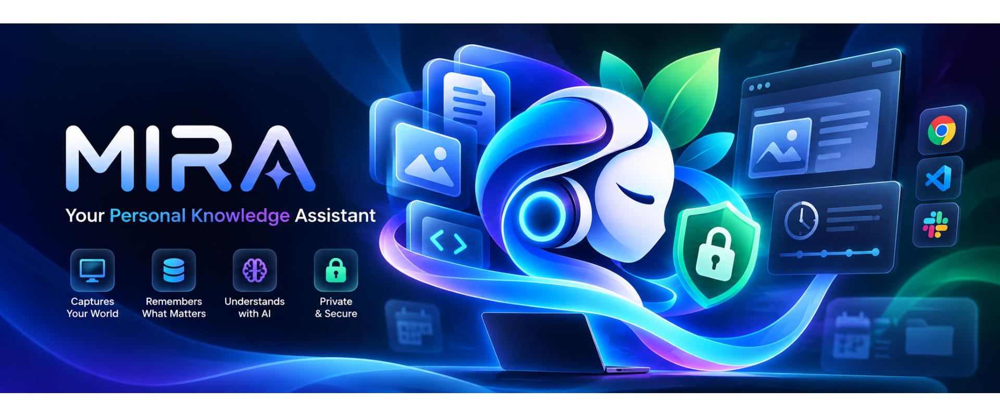

<p align="center">
  
</p>

<p align="center">
  
</p>

<h1 align="center">MIRA</h1>
<p align="center"><strong>Memory • Intelligence • Recall • Assistant</strong></p>

<p align="center">
  <em>An autonomous, context-aware AI assistant and personal digital memory that anticipates your needs, organizes your day, and keeps your private data strictly on your device.</em>
</p>

<p align="center">
  
  
  
  
  
</p>

---

## ⚡ Quick Start & Installation

<p align="center">
  
</p>

MIRA runs as a native desktop application on **Windows** (bundled microservices) or in **Web Development mode**.

### Option A: Install Windows Desktop App (Recommended)
Download and execute the official NSIS installer:
```powershell
# Built setup installer:
Client\src-tauri\target\release\bundle\nsis\MIRA_0.1.0_x64-setup.exe
```
* **Single Installer:** Fully bundles Python backend services, Redis server, and the native Rust operator.
* **Auto-Lifecycle:** Automatically boots child microservices on launch and shuts them down cleanly on exit.
* **Clean Uninstaller:** Uninstalls cleanly via Windows Settings > Installed Apps.

### Option B: Run in Development / Web Mode
Start all services simultaneously in development mode with automatic port conflict handling:
```powershell
python scripts/start.py
```
Then navigate to **`http://localhost:9004`** in your browser.

### Option C: Build from Source
Package native binaries and installers across platforms:
```powershell
python scripts/build.py
```
> For detailed build pipeline flags, targets, and version bumping, see [`scripts/README.md`](scripts/README.md).

---

## 🌟 What Is MIRA?

**MIRA** captures your digital workflow (browsing, applications, projects, learning), builds a searchable local knowledge graph, and provides proactive personal intelligence without exposing your raw private data to cloud providers.

Traditional assistants wait for prompts. MIRA operates in two complementary modes:
- **Reactive Assistance:** Instant recall of past activities, documents, decisions, and contextual answers via natural language or voice.
- **Proactive Intelligence:** Prepares daily schedules, personalized morning news briefings, relevant career/job matches, and learning roadmaps ahead of time.

---

## 🏛️ The Four Pillars

| Pillar | Description |
| :--- | :--- |
| **🧠 Memory** | Continuous, low-overhead capture of digital activities, OCR text, and user context saved locally. |
| **⚡ Intelligence** | Hybrid AI reasoning: local semantic retrieval paired with state-of-the-art LLMs for synthesis. |
| **🔍 Recall** | Natural language search across your past actions, open files, notes, and project milestones. |
| **🤖 Assistant** | Proactive daily planning, automated briefings, and system-level task execution. |

---

## 🚀 Key Features

* **Local-First Knowledge Base:** All raw activity logs, perceptual hashes, SQLite databases, and Qdrant vector indexes remain strictly on your physical machine.
* **Proactive Daily Briefings:**
  * 🌅 *Morning Agenda:* Automatically organizes tasks, unfinished project items, and meetings.
  * 📰 *Curated News:* Deduplicated topic briefings prepared before your scheduled reading hour.
  * 🎯 *Career & Learning:* Identifies job listings matching your skills and curates tutorials for ongoing study goals.
* **Project Continuity:** Pick up right where you left off. MIRA tracks project files, recent edits, and blockers across multiple workspaces.
* **Voice & Conversational UI:** Voice input and spoken feedback with minimal audio retention and local transcription options.
* **Native Desktop Operator:** Built in Rust for ultra-fast screen capture (`xcap`), window monitoring, and controlled OS-level automation.

---

## 🛡️ Privacy & Hybrid Architecture

<p align="center">
  
</p>

MIRA separates **private data storage** from **language reasoning**:

```text
┌────────────────────────────────────────────────────────┐
│                   YOUR LOCAL DEVICE                    │
│  • Screen & OS Capture (Rust Operator)                 │
│  • Image Processing, OCR & Perceptual Hashing (Memory) │
│  • Local Databases (SQLite, Qdrant Vector Index)       │
│  • Central Configuration & Secrets (Vault)             │
└───────────────────────────┬────────────────────────────┘
                            │
               Context Minimization Gateway
        (Strips private data; sends minimal excerpt)
                            │
                            ▼
┌────────────────────────────────────────────────────────┐
│                    CLOUD AI SERVICES                   │
│  • LLM Reasoning (Task-specific prompt only)           │
│  • Speech-to-Text & Text-to-Speech (Optional)          │
└────────────────────────────────────────────────────────┘
```

1. **Context Minimization:** Only the precise, relevant snippet needed for a specific prompt is sent to cloud LLMs—never your entire database or full screen history.
2. **Local by Default:** Raw screenshots, embeddings, activity timelines, and personal files never leave your computer.
3. **Controlled Automation:** OS-level operations (file modifications, app launches) are restricted by a local permission gateway requiring user confirmation.

---

## 🏗️ System Architecture

MIRA is built as an event-driven microservices architecture communicating through a centralized message broker. All configurations, secrets, and audit logs are managed by Vault.

```text
                          ┌──────────────────┐
                          │      Client      │
                          │  Tauri 2 / React │
                          └────────┬─────────┘
                                   │
                                   ▼
                    ┌──────────────────────────────┐
                    │        Message Broker        │
                    │   Redis Streams & HTTP API   │
                    └───▲──────┬────────▲──────┬───┘
                        │      │        │      │
         ┌──────────────┘      │        │      └──────────────┐
         ▼                     ▼        ▼                     ▼
┌──────────────────┐  ┌──────────────────┐  ┌──────────────────┐
│     Operator     │  │      Engine      │  │      Memory      │
│  Rust / Axum OS  │  │ LangChain / LLMs │  │ OCR & Qdrant RAM │
└──────────────────┘  └──────────────────┘  └──────────────────┘
         ▲                     ▲                      ▲
         │                     │                      │
         └──────────────┐      │      ┌───────────────┘
                        │      │      │
                     ┌──┴──────┴──────┴──┐
                     │       Vault       │
                     │  Config & Secrets │
                     └───────────────────┘
```

### Core Data Flows

1. **Centralized Messaging:** All inter-module communication, job queuing, and event streaming routes strictly through the central Message Broker (Redis Streams).
2. **Centralized Configuration & Secrets:** Vault stores encrypted credentials, parameters, feature flags, and logs. Modules load configs at startup and sync updates via the broker.
3. **Capture Pipeline:** Operator runs as a native Rust service, captures screen frames and OS activity, and publishes raw frames directly to the broker.
4. **Image Processing & Memory Storage:** Memory consumes raw screenshots, executes frame comparisons and perceptual hashing, runs LRU OCR caching, and indexes extracted text into Qdrant (vector embeddings) and SQLite (structured metadata).
5. **AI Interaction:** Client dispatches user prompts to Engine via the broker. Engine pulls contextual history from Memory, queries cloud/local LLMs, and streams responses back to Client.
6. **Dynamic Service Discovery:** A unified `services.json` dynamically maps service URLs, enabling zero-hardcoding and automatic port conflict resolution.
7. **Unified Lifecycle Management:** `scripts/start.py` orchestrates dependency boot ordering, port checks, health probes, and graceful teardown across all services.

### Microservice Manifest

| Service | Tech Stack | Role |
| :--- | :--- | :--- |
| **Client** | Tauri 2, React 18, TypeScript, Tailwind | Desktop application shell & Web UI |
| **Message Broker** | FastAPI, Redis Streams | Central communication hub & async event streaming |
| **Vault** | FastAPI, SQLCipher, Keyring | Encrypted configuration, secret store & audit logs |
| **Engine** | Python, LangChain, LangGraph | AI reasoning, context synthesis & LLM coordination |
| **Memory** | Python, Tesseract OCR, Qdrant, SQLite | Image hashing, OCR extraction, vector search & recall |
| **Operator** | Rust, Axum, Tokio, `xcap` | Low-level OS automation, screen capture & input handling |

### Module Breakdown

#### 1. Message Broker
* **Role:** Central asynchronous communication hub and data transfer backbone for all MIRA services.
* **Capabilities:** Manages queues, event streams, delivery guarantees, retries, and job routing.
* **Technology:** Python (`asyncio`, FastAPI, `httpx`), Redis (Redis Streams).

#### 2. Operator
* **Role:** Low-level OS operations, desktop screen captures, and system automation.
* **Capabilities:** Exposes local control APIs, captures displays via `xcap`, and streams raw frames directly to the broker.
* **Technology:** Rust (Axum / Actix-web, Tokio async runtime, `reqwest`, `xcap`).

#### 3. Memory
* **Role:** Ingests raw frames, executes image processing, and manages short/long-term recall.
* **Capabilities:** Perceptual hashing (Pillow, ImageHash), LRU OCR text caching (Tesseract), semantic vector embeddings, and keyword search.
* **Technology:** Python (`asyncio`, Pydantic), Pillow, ImageHash, Tesseract OCR (`pytesseract`), Qdrant (local), SQLite.

#### 4. Engine
* **Role:** Coordinates AI workflows, prompt construction, and model execution.
* **Capabilities:** Queries Memory for relevant context, interfaces with local/cloud LLMs, and routes structured responses back to the Client.
* **Technology:** Python (`asyncio`, Pydantic), LangChain, LangGraph.

#### 5. Client
* **Role:** Desktop and web user interface for chat, voice assistant, activity insights, and manual controls.
* **Capabilities:** Dispatches queries, visualizes real-time status, and renders streamed AI responses.
* **Technology:** React 18, TypeScript, Tailwind CSS, Vite, Tauri 2 (Rust desktop shell).

#### 6. Vault
* **Role:** Centralized, encrypted repository for application configurations, credentials, and audit logs.
* **Capabilities:** Stores LLM API keys and secrets via OS Keyring, serves startup configs, broadcasts configuration sync events, and secures local records.
* **Technology:** Python, FastAPI, Uvicorn, SQLite + SQLCipher (`sqlcipher3`), OS Keyring (`keyring`), ChaCha20-Poly1305 / AES-GCM.

---

## 🛠️ Tech Stack

* **Desktop & UI:** [Tauri v2](https://v2.tauri.app/), [React 18](https://react.dev/), [TypeScript](https://www.typescriptlang.org/), [Tailwind CSS](https://tailwindcss.com/), [Vite](https://vitejs.dev/)
* **System Engine:** [Rust](https://www.rust-lang.org/) (`axum`, `tokio`, `xcap`, `reqwest`)
* **AI & Orchestration:** Python 3.11, [FastAPI](https://fastapi.tiangolo.com/), [LangChain](https://www.langchain.com/), [LangGraph](https://langchain-ai.github.io/langgraph/)
* **Storage & Vectors:** [SQLite](https://www.sqlite.org/) with FTS5, [Qdrant](https://qdrant.tech/) (Local), [SQLCipher](https://www.zetetic.net/sqlcipher/)
* **Event Broker:** [Redis](https://redis.io/) (Redis Streams)
* **Vision & OCR:** [Tesseract OCR](https://github.com/tesseract-ocr/tesseract), Pillow, ImageHash

---

## 📄 License

This project is licensed under the MIT License.
