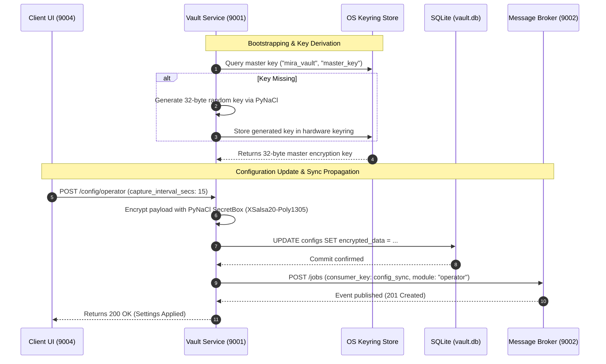

# MIRA Vault Module (Encrypted Configuration, Secrets & Audit Vault)

> **The zero-trust security and persistence backbone of MIRA: managing authenticated encryption for secrets, housing local SQLite databases, enforcing audit log retention, and securing LLM credentials.**

---

## Table of Contents
- [1. Module Overview](#1-module-overview)
- [2. Module Contents](#2-module-contents)
- [3. How It Communicates](#3-how-it-communicates)
- [4. Technology Stack](#4-technology-stack)
- [5. Architecture Flow Diagram](#5-architecture-flow-diagram)

---

<a id="1-module-overview"></a><a id="module-overview"></a>
## 1. Module Overview

### 1.1 Architectural Purpose
The **Vault** module is the foundational security, configuration authority, and encrypted database microservice of MIRA, running on port **`9001`**. In an autonomous assistant that observes desktop activity and processes natural language, security cannot be an afterthought. The Vault enforces a strict **Zero-Trust Local Storage Model**: all persistent records—including user profiles, AI provider API keys (Gemini, Groq), priority rankings, per-application screen capture permissions, multi-session chat histories, daily executive briefings, and system telemetry logs—are encrypted before being committed to disk.

The Vault derives its master cryptographic keys directly from the host operating system's native hardware-backed credential store (Apple Keychain on macOS, Windows Credential Manager on Windows, and SecretService / GNOME Keyring on Linux). Operating as the first microservice booted during the system lifecycle, it serves startup parameters to all sibling modules (Broker, Operator, Memory, Engine, Client) and broadcasts real-time configuration update notifications across the Message Broker whenever settings change.

---

### 1.2 Key Capabilities
- **Zero-Knowledge Authenticated Encryption**: Implements authenticated symmetric encryption using **PyNaCl** (libsodium SecretBox / XSalsa20-Poly1305), guaranteeing that database files cannot be decrypted without the host machine's hardware keyring.
- **Hardware-Backed Key Derivation**: Integrates with the host operating system's secure credential vault via the Python `keyring` library, eliminating plaintext passwords and hardcoded secrets.
- **Single Source of Truth for Configs**: Stores and dynamically serves verified configuration dictionaries for all MIRA microservices (`logs`, `message_broker`, `operator`, `user_details`, `ai_priorities`).
- **AI Credential & Worker Limits Authority**: Secures third-party API keys, defines active model priority hierarchies (e.g. Gemini $\to$ Groq failover), and manages concurrency worker bounds.
- **Encrypted Audit Logging & Automated Retention**: Collects cryptographically sealed audit events across all services, providing query filters and automated retention cleanup to purge expired entries.
- **Chat History & User Profile Database**: Encrypts and persists conversational chat sessions, message turns, unread states, user names, and work preferences.
- **Application Permission Control**: Manages the master whitelist/blacklist of system applications allowed to undergo desktop screen capture.

> [!TIP]
> **Unified Installation & Execution**: To install and run the Vault module alongside the full MIRA ecosystem, see the centralized [Scripts & Installation Guide](../scripts/README.md).

---

<a id="2-module-contents"></a><a id="module-contents"></a>
## 2. Module Contents

### 2.1 Directory & File Manifest
```
Vault/
├── api.py                    # Comprehensive REST route implementations & Pydantic models
├── app.py                    # FastAPI application initialization & Uvicorn startup
├── config.py                 # Service discovery (services.json), directory roots, & defaults
├── config_storage.py         # Encrypted SQLite storage engine & migration controllers
├── crypto.py                 # PyNaCl SecretBox wrapper, keyring key retrieval, & hashing
├── log_manager.py            # Encrypted audit log management & retention pruning engine
├── requirements.txt          # Python package requirements
├── schema.sql                # SQLite database schema definitions
└── system/                   # Encrypted local storage directory (auto-created)
    ├── vault.db              # Encrypted SQLite database file
    ├── audit_logs.db         # Encrypted audit logs database
    └── knowledge_base/       # Root storage path for Qdrant vector partitions
```

---

### 2.2 Core Subsystems & Components

#### 1. Cryptographic Engine (`crypto.py`)
- **Keyring Handshake**: Interacts with the host OS keyring (`keyring.get_password("mira_vault", "master_key")`). If no key exists on initial launch, generates a cryptographically secure 32-byte key via `nacl.utils.random(32)` and seals it into the OS keyring.
- **PyNaCl SecretBox**: Performs authenticated symmetric encryption (XSalsa20 stream cipher + Poly1305 MAC). Every ciphertext payload includes a unique 24-byte nonce to prevent replay attacks.
- **Key Hashing & Masking**: Exposes API helpers to mask sensitive API keys (`sk-...` $\to$ `sk-****abcd`) for secure presentation in the Client UI.

#### 2. Configuration & State Database (`config_storage.py`)
- Manages `system/vault.db` containing configuration tables (`configs`, `users`, `ai_configs`, `ai_priorities`, `apps_permissions`, `chat_sessions`, `chat_messages`, `daily_suggestions`).
- Every string value, prompt override, and credential is encrypted before execution of SQLite `INSERT`/`UPDATE` operations and decrypted on `SELECT`.

#### 3. Audit Logging & Retention Engine (`log_manager.py`)
- Manages `system/audit_logs.db`. Accepts log entries from all microservices, attaches ISO timestamps, service identifiers, and severity levels, and encrypts log bodies.
- Enforces user-configured retention policies (`1 day`, `7 days`, `30 days`, `Never auto delete`) by running automated batch cleanup queries.

---

### 2.3 Cryptographic Model & OS Keyring Integration
```
┌────────────────────────────────────────────────────────┐
│             Native OS Hardware Keyring                 │
│  (macOS Keychain / Windows Credential / Linux Secret)  │
└──────────────────────────┬─────────────────────────────┘
                           │ master_key (32 bytes)
                           ▼
┌────────────────────────────────────────────────────────┐
│                   PyNaCl SecretBox                     │
│               XSalsa20-Poly1305 Cipher                 │
└──────────────┬───────────────────────────▲─────────────┘
  Plaintext    │ Encrypt                   │ Decrypt
  Settings     ▼                           │ Ciphertext
┌────────────────────────────────────────────────────────┐
│              Local SQLite Encrypted Storage            │
│                 (system/vault.db)                      │
└────────────────────────────────────────────────────────┘
```

---

<a id="3-how-it-communicates"></a><a id="how-it-communicates"></a>
## 3. How It Communicates

### 3.1 Incoming Endpoints & Ports
The Vault service listens on port **`9001`** and serves as the security authority for the entire ecosystem:

| Method | Endpoint | Description & Usage |
| :--- | :--- | :--- |
| `GET` | `/health` | Microservice health check (`{"service": "Vault", "status": "online"}`). |
| `GET` | `/config/{key}` | Retrieves encrypted configuration records by module key (`operator`, `logs`, `message_broker`). |
| `POST` | `/config/{key}` | Updates and persists configuration for a specific module key. |
| `GET` | `/user` | Fetches the encrypted user profile (name, title, work style, preferences). |
| `POST` | `/user` | Updates the encrypted user profile details. |
| `GET` | `/ai/providers` | Returns list of supported LLM provider keys (`["gemini", "groq"]`). |
| `GET` | `/ai/configs` | Lists all stored AI provider configurations with safely masked API keys. |
| `GET` | `/ai/configs/{provider}` | Reads configuration and decrypted credentials for a specific provider. |
| `POST` | `/ai/configs/{provider}` | Stores or updates credentials and model parameters for a provider. |
| `DELETE`| `/ai/configs/{provider}` | Removes an AI provider's credentials. |
| `GET` | `/ai/priorities` | Retrieves the active AI provider failover sequence (e.g. `["gemini", "groq"]`). |
| `PUT` | `/ai/priorities` | Updates the AI provider priority order. |
| `GET` | `/news/config` | Reads GNews API credentials and active category filters. |
| `POST` | `/news/config` | Configures GNews API token and search topics. |
| `GET` | `/engine/workers` | Serves concurrency limits and polling intervals to Engine and Memory workers. |
| `PUT` | `/engine/workers` | Updates concurrency and polling timing parameters. |
| `GET` | `/system/storage` | Returns the resolved absolute file path for local vector database storage. |
| `GET` | `/apps` | Lists all registered applications with their screen capture permission status. |
| `POST` | `/apps/refresh` | Ingests an updated registry of discovered applications from the Operator. |
| `POST` | `/apps/permission` | Sets whitelist or blacklist capture status for an application. |
| `POST` | `/logs` | Ingests a new diagnostic or operational log entry from any microservice. |
| `GET` | `/logs` | Queries encrypted audit logs with pagination, service filtering, and level filtering. |
| `DELETE`| `/logs` | Truncates or deletes audit logs. |
| `POST` | `/retention/cleanup` | Evaluates audit log retention rules and deletes expired entries. |
| `POST` | `/crypto/encrypt` | Utility endpoint encrypting plaintext strings using Vault's master key. |
| `POST` | `/crypto/decrypt` | Utility endpoint decrypting Vault ciphertext payloads. |
| `GET` | `/chats/sessions` | Lists all conversational chat sessions with message counts and timestamps. |
| `GET` | `/chats/sessions/{id}` | Fetches message history for a specific chat session. |
| `POST` | `/chats` | Appends a user or assistant message to an encrypted chat session. |
| `DELETE`| `/chats/sessions/{id}` | Deletes a chat session and all associated messages. |
| `GET` | `/daily_suggestions/latest` | Retrieves the most recently generated daily briefing. |
| `POST` | `/daily_suggestions` | Persists a newly synthesized daily briefing payload. |

---

### 3.2 Outgoing Microservice Communication
The Vault service communicates outbound with the Message Broker to propagate configuration state:

#### Message Broker Service (Port `9002`)
| Method | Endpoint | Purpose & Usage |
| :--- | :--- | :--- |
| `POST` | `/jobs` | Dispatches configuration synchronization events (`consumer_key: config_sync`) whenever settings, AI keys, or application permissions are updated. |

---

### 3.3 Message Broker & Event Synchronization
Whenever a user modifies settings in the Client UI, Vault commits the change to SQLite and pushes a notification:

| Stream / Consumer Key | Role | Payload Content | Purpose |
| :--- | :--- | :--- | :--- |
| **`config_sync`** | **Producer** | `module`: Config identifier<br>`timestamp`: Epoch milliseconds<br>`action`: `"updated"` | Prompts Operator, Memory, and Engine to reload their cached configuration in memory without restarts. |

---

<a id="4-technology-stack"></a><a id="technology-stack"></a>
## 4. Technology Stack

| Domain | Technology / Library | Version | Architectural Rationale |
| :--- | :--- | :--- | :--- |
| **API Framework** | **FastAPI** | `^0.110.0` | Asynchronous REST routing, dependency injection, and Pydantic request validation. |
| **ASGI Server** | **Uvicorn** | `^0.28.0` | Production-grade ASGI runtime powering low-latency concurrent HTTP handlers. |
| **Cryptography** | **PyNaCl (libsodium)** | `^1.5.0` | Authenticated symmetric encryption (XSalsa20 stream cipher + Poly1305 MAC). |
| **Key Management** | **keyring** | `^24.0.0` | Bridges Python to native OS secure credential stores (Keychain, Credential Manager, SecretService). |
| **Embedded Database** | **SQLite3** | Standard Lib | Serverless, zero-configuration local relational database engine storing encrypted tables. |
| **Data Validation** | **Pydantic v2** | `^2.6.0` | Strict schema serialization, input sanitization, and automatic OpenAPI generation. |
| **HTTP Client** | **Requests** | `^2.31.0` | Outbound HTTP client dispatching config sync notifications to Message Broker. |

---

<a id="5-architecture-flow-diagram"></a><a id="architecture-flow-diagram"></a>
## 5. Architecture Flow Diagram


