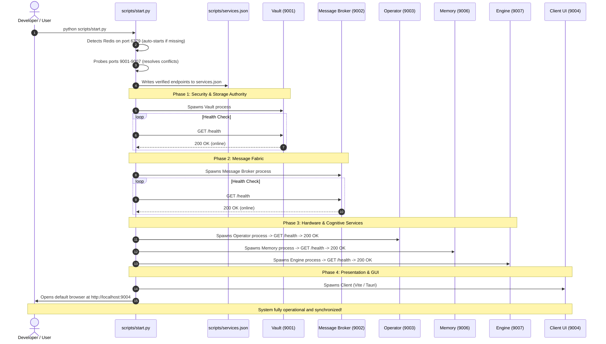

# MIRA Scripts & Orchestration Toolkit

> **The centralized orchestration, service discovery, build pipeline, and unified installation engine for the entire MIRA ecosystem.**

---

## Table of Contents
- [1. Module Overview](#1-module-overview)
- [2. Unified Installation Guide](#2-unified-installation-guide)
- [3. Module Contents](#3-module-contents)
- [4. How It Communicates & Orchestrates](#4-how-it-communicates--orchestrates)
- [5. Technology Stack](#5-technology-stack)
- [6. Architecture Flow Diagram](#6-architecture-flow-diagram)

---

<a id="1-module-overview"></a><a id="module-overview"></a>
## 1. Module Overview

### 1.1 Architectural Purpose
The **Scripts & Orchestration** module is the central command, build, and lifecycle supervision system of MIRA. Rather than requiring developers and users to manually open seven separate terminal windows, calculate non-conflicting network ports, verify database ready-states, and launch microservices individually, the scripts directory provides a unified Python-based orchestration engine. 

Operating from the project root, the orchestration toolkit manages three core responsibilities:
1. **Dynamic Service Discovery & Lifecycle Management (`start.py`)**: Automatically detects local Redis servers, checks TCP socket availability, dynamically resolves port collisions by auto-incrementing conflicting ports, writes updated endpoints to `services.json`, boots microservices in strict dependency order (`Vault` $\to$ `Message Broker` $\to$ `Operator` $\to$ `Memory` $\to$ `Engine` $\to$ `Client`), polls `/health` endpoints for readiness, multiplexes color-coded log streams, and enforces clean process-tree teardown upon exit.
2. **Cross-Platform Compilation & Packaging (`build.py`)**: Automates the multi-stage compilation pipeline across Windows, macOS, and Linux—compiling the native Rust Operator, packaging the React/TypeScript frontend via Vite, staging microservices into Tauri bundle resources, and producing native installers (`.exe`, `.dmg`, `.deb`, `.AppImage`).
3. **Atomic Version Synchronization**: Serves as the single source of truth for versioning, atomically querying and updating version strings across four independent configuration files simultaneously (`package.json`, `tauri.conf.json`, `Client/Cargo.toml`, and `Operator/Cargo.toml`).

---

### 1.2 Key Capabilities
- **Single-Command Ecosystem Boot**: Spawns all backend microservices, local Redis instances, and the desktop GUI with a single command (`python scripts/start.py`).
- **Dynamic Port Collision Avoidance**: Tests default ports (`9001`–`9007`) prior to startup; if a port is occupied by another application, it automatically binds to the next available socket and updates `services.json` and `.env.local`.
- **Dependency-Ordered Health Gating**: Guarantees that downstream consumers (such as Engine and Memory) never launch until prerequisite providers (Vault and Message Broker) pass their `/health` checks.
- **Multiplexed Color-Coded Log Streaming**: Merges standard output and error streams from all background microservices into a unified console with distinct prefixes (`[VAULT]`, `[BROKER]`, `[OPERATOR]`, `[MEMORY]`, `[ENGINE]`, `[CLIENT]`).
- **Graceful Process Tree Termination**: Catches `SIGINT` (`Ctrl+C`) and `SIGTERM` signals to terminate all spawned child process trees cleanly, preventing rogue or orphaned background processes.
- **Unified Cross-Platform Packaging**: Builds signed, standalone distribution artifacts for Windows (NSIS `.exe`), macOS (`.dmg` and `.app`), and Linux (`.deb` and `.AppImage`).
- **Atomic Multi-Target Version Bumping**: Programmatically verifies and bumps versions across Rust, TypeScript, and Tauri configs with built-in rollback protection.

---

<a id="2-unified-installation-guide"></a><a id="unified-installation-guide"></a>
## 2. Unified Installation Guide

> [!NOTE]
> All commands should be executed from the **project root directory** (`Mira/`), unless explicitly noted otherwise.

### 2.1 Complete System Prerequisites
Before installing MIRA, ensure your host machine has the following foundational dependencies:

| Dependency | Minimum Version | Recommended | Required By |
| :--- | :--- | :--- | :--- |
| **Python** | `3.10` | `3.11.x` | Vault, Message Broker, Memory, Engine, `start.py` |
| **Node.js** | `v18.0.0` | `v20.x` LTS | Client (React 19, Vite, Tailwind v4) |
| **Rust Toolchain** | `1.75.0` | Latest Stable | Operator (native capture) and Client (Tauri v2 shell) |
| **Redis Server** | `v6.2` | `v7.x` | Message Broker event streams and image caching |
| **Tesseract OCR** | `v5.0` | Latest | Memory (perceptual text extraction) |
| **Git** | `2.30+` | Latest | Source control and submodules |

---

### 2.2 macOS Setup Guide
```bash
# 1. Install system prerequisites using Homebrew
brew update
brew install python@3.11 node rust redis tesseract tesseract-lang

# 2. Start the Redis background service
brew services start redis
# Verify Redis is responding:
redis-cli ping  # Output: PONG

# 3. Clone repository and navigate to root
git clone https://github.com/DhirajKarangale/Mira.git
cd Mira

# 4. Set up Python virtual environments and dependencies for microservices
# Vault
python3.11 -m venv Vault/venv && source Vault/venv/bin/activate && pip install -r Vault/requirements.txt && deactivate
# Message Broker
python3.11 -m venv Message_Broker/venv && source Message_Broker/venv/bin/activate && pip install -r Message_Broker/requirements.txt && deactivate
# Memory
python3.11 -m venv Memory/venv && source Memory/venv/bin/activate && pip install -r Memory/requirements.txt && deactivate
# Engine
python3.11 -m venv Engine/venv && source Engine/venv/bin/activate && pip install -r Engine/requirements.txt && deactivate

# 5. Build native Rust Operator binary
cd Operator && cargo build --release && cd ..

# 6. Install frontend NPM dependencies
cd Client && npm install && cd ..

# 7. Launch the entire MIRA ecosystem!
python3 scripts/start.py
```

> [!IMPORTANT]
> **macOS Screen Recording Permission**: On macOS, you must grant Screen Recording permissions to your terminal or IDE under **System Settings > Privacy & Security > Screen Recording**, otherwise `Operator` will capture blank desktop frames.

---

### 2.3 Windows 10/11 Setup Guide
```powershell
# 1. Install prerequisites via Chocolatey (run PowerShell as Administrator)
# If Chocolatey is not installed: https://chocolatey.org/install
choco install -y python311 nodejs rustup.install tesseract memurai-developer

# Ensure Rust stable toolchain is configured
rustup default stable

# 2. Verify Memurai (Redis 7 compatible for Windows) is running:
redis-cli ping  # Output: PONG

# 3. Ensure C:\Program Files\Tesseract-OCR is in your system PATH
$env:Path += ";C:\Program Files\Tesseract-OCR"

# 4. Navigate to project root
cd Mira

# 5. Set up Python virtual environments and install requirements
# Vault
python -m venv Vault\venv; .\Vault\venv\Scripts\Activate.ps1; pip install -r Vault\requirements.txt; deactivate
# Message Broker
python -m venv Message_Broker\venv; .\Message_Broker\venv\Scripts\Activate.ps1; pip install -r Message_Broker\requirements.txt; deactivate
# Memory
python -m venv Memory\venv; .\Memory\venv\Scripts\Activate.ps1; pip install -r Memory\requirements.txt; deactivate
# Engine
python -m venv Engine\venv; .\Engine\venv\Scripts\Activate.ps1; pip install -r Engine\requirements.txt; deactivate

# 6. Build native Rust Operator
cd Operator; cargo build --release; cd ..

# 7. Install Client dependencies
cd Client; npm install; cd ..

# 8. Launch all microservices
python scripts\start.py
```

---

### 2.4 Linux Setup Guide (Ubuntu / Debian / Fedora / Arch)

#### Ubuntu / Debian:
```bash
# 1. Install system development libraries, Redis, and Tesseract
sudo apt-get update
sudo apt-get install -y python3 python3-venv python3-pip nodejs npm redis-server \
  tesseract-ocr libtesseract-dev libgl1-mesa-glx libglib2.0-0 \
  build-essential libx11-dev libxrandr-dev libxi-dev libssl-dev \
  libwebkit2gtk-4.1-dev libayatana-appindicator3-dev librsvg2-dev

# 2. Install Rust
curl --proto '=https' --tlsv1.2 -sSf https://sh.rustup.rs | sh -s -- -y
source $HOME/.cargo/env

# 3. Start Redis service
sudo systemctl enable --now redis-server

# 4. Setup Python virtual environments in root
cd Mira
for mod in Vault Message_Broker Memory Engine; do
  python3 -m venv $mod/venv && source $mod/venv/bin/activate && pip install -r $mod/requirements.txt && deactivate
done

# 5. Build Operator & Install Client dependencies
cd Operator && cargo build --release && cd ..
cd Client && npm install && cd ..

# 6. Launch MIRA
python3 scripts/start.py
```

#### Fedora:
```bash
sudo dnf install -y python3 python3-devel nodejs redis tesseract tesseract-devel \
  mesa-libGL glib2-devel gcc gcc-c++ libX11-devel libXrandr-devel libXi-devel openssl-devel \
  webkit2gtk4.1-devel libappindicator-gtk3-devel librsvg2-devel
sudo systemctl enable --now redis
# Follow setup steps 4-6 from Ubuntu
```

#### Arch Linux:
```bash
sudo pacman -S python python-pip nodejs npm redis tesseract tesseract-data \
  base-devel libx11 libxrandr libxi openssl webkit2gtk-4.1 libappindicator-gtk3 librsvg
sudo systemctl enable --now redis
# Follow setup steps 4-6 from Ubuntu
```

---

### 2.5 Quick One-Command Launch
Once initial prerequisites and virtual environments are set up, launching MIRA requires just one command:

```bash
# Starts Redis, Vault, Message Broker, Operator, Memory, Engine, and Client UI:
python3 scripts/start.py

# Windows PowerShell:
python scripts\start.py
```

### 2.6 CLI Execution Flags for `start.py`

| Flag | Description |
| :--- | :--- |
| *(no flags)* | Starts all backend microservices and launches the Client in your default browser. |
| `--no-client` | Starts all backend microservices without opening the browser client (used by Tauri desktop runtime). |
| `--prod` | Launches Python services in production mode (disables FastAPI `reload=True` file watchers). |
| `--headless` | Runs in non-interactive background mode (suppresses interactive banners). |

---

### 2.7 Packaging Production Desktop Installers (`build.py`)
To compile and package MIRA into a standalone installer for your platform:

```bash
# Run full automated build for the current operating system
python3 scripts/build.py
# (Windows): python scripts\build.py
```

#### Installer Output Locations:
- **Windows:** `Client/src-tauri/target/release/bundle/nsis/MIRA_<version>_x64-setup.exe`
- **macOS:** `Client/src-tauri/target/release/bundle/dmg/MIRA_<version>_x64.dmg` (and `.app`)
- **Linux:** `Client/src-tauri/target/release/bundle/deb/` and `appimage/`

---

### 2.8 Version Querying & Atomic Bumping
MIRA keeps versions strictly synchronized across four project targets:
1. `Client/src-tauri/tauri.conf.json`
2. `Client/package.json`
3. `Client/src-tauri/Cargo.toml`
4. `Operator/Cargo.toml`

```bash
# Query the active project version:
python3 scripts/build.py -v

# Atomically update all four files simultaneously:
python3 scripts/build.py --set-version 0.2.0
```

---

<a id="3-module-contents"></a><a id="module-contents"></a>
## 3. Module Contents

### 3.1 Directory & File Manifest
```
scripts/
├── services.json             # Dynamic Service Discovery Registry (ports & base URLs)
├── start.py                  # Master lifecycle starter, port resolver, & process supervisor
├── build.py                  # Multi-target cross-platform packager & version synchronization engine
└── README.md                 # Complete documentation and unified installation guide
```

---

### 3.2 Core Subsystems & Components

#### 1. Dynamic Service Discovery (`services.json`)
- Stores active service endpoint mappings. Loaded at boot by all microservices to eliminate hardcoded URLs.
- Automatically updated on the fly by `start.py` whenever a port conflict requires reallocation.

#### 2. Multi-Service Lifecycle Starter (`start.py`)
- **Socket Testing (`find_free_port`)**: Opens non-blocking TCP sockets on candidate ports. If bound, steps sequentially until a free socket is found.
- **Dependency Orchestration**: Boots services in strict architectural dependency order with health check retry backoff loops (`/health`).
- **Process Supervision**: Spawns processes with `subprocess.Popen`, sets process group IDs (`setsid` on Unix, `CREATE_NEW_PROCESS_GROUP` on Windows), and kills entire process trees on shutdown.
- **Log Multiplexer**: Spawns background reader threads per process, prepending stylized ANSI color tags to every log line.

#### 3. Cross-Platform Compilation Pipeline (`build.py`)
- Executes a 6-stage build sequence:
  1. Validates host dependencies (Rust, Node, Python).
  2. Compiles `Operator` release binary via `cargo build --release`.
  3. Bundles frontend assets via `npm run build` in `Client/`.
  4. Stages Python microservice trees and `start.py` into Tauri resource staging directories.
  5. Configures Tauri bundle manifests and permission maps.
  6. Triggers `cargo tauri build` to output native installers.

---

<a id="4-how-it-communicates--orchestrates"></a><a id="how-it-communicates-orchestrates"></a>
## 4. How It Communicates & Orchestrates

### 4.1 Port Map & Dynamic Allocation
`services.json` defines the default port allocations for the MIRA microservice network:

| Service | Default Port | Protocol | Primary Architectural Role |
| :--- | :---: | :---: | :--- |
| **Redis Server** | `6379` | `TCP` | In-memory stream message broker backbone and comparison cache. |
| **Vault** | `9001` | `HTTP` | Encrypted secrets, OS keyring derivation, configuration authority, and audit logs. |
| **Message Broker** | `9002` | `HTTP` | Redis Streams wrapper, job queuing (`ocr_extraction`, `ocr_summarization`, `embedding_memory`). |
| **Operator** | `9003` | `HTTP` | Native Rust screen capture, active window tracking, and app permission guard. |
| **Client UI** | `9004` | `HTTP / WS` | React 19 desktop GUI, ambient voice assistant, and Vite HMR. |
| **Memory** | `9006` | `HTTP` | OpenCV frame diffing, Tesseract OCR extraction, and local Qdrant vector database. |
| **Engine** | `9007` | `HTTP / WS` | LLM inference coordinator, multi-turn chat streaming, and daily executive briefings. |

---

### 4.2 Dynamic Conflict Resolution
When `start.py` launches, it tests each default port. If a port is already occupied:
1. `start.py` increments to the next available socket (e.g. `9001` $\to$ `9005`).
2. Updates `scripts/services.json` with the newly assigned URL.
3. Automatically writes `Client/.env.local` with updated Vite environment variables.
4. Passes assigned ports to microservices via `PORT` environment variables.

---

### 4.3 Dependency-Ordered Boot Sequence
`start.py` launches services sequentially, verifying `/health` endpoints before advancing:

```
[1. Redis Server: 6379]
         │ (Socket verified)
         ▼
[2. Vault: 9001] ───────────────► Polled: GET http://127.0.0.1:9001/health (200 OK)
         │
         ▼
[3. Message Broker: 9002] ──────► Polled: GET http://127.0.0.1:9002/health (200 OK)
         │
         ▼
[4. Operator: 9003] ────────────► Polled: GET http://127.0.0.1:9003/health (200 OK)
         │
         ▼
[5. Memory: 9006] ──────────────► Polled: GET http://127.0.0.1:9006/health (200 OK)
         │
         ▼
[6. Engine: 9007] ──────────────► Polled: GET http://127.0.0.1:9007/health (200 OK)
         │
         ▼
[7. Client UI: 9004] ───────────► Polled: GET http://127.0.0.1:9004/ (200 OK) -> Launch Browser
```

---

### 4.4 Graceful Teardown Flow
When `start.py` receives `Ctrl+C` (`SIGINT`) or `SIGTERM`:
1. Traps signal and halts incoming process spawn queues.
2. Sends `SIGTERM` / `WM_CLOSE` to child process group IDs.
3. Allows 3 seconds for graceful in-flight flush (Vault commits SQLite transactions, Memory closes Qdrant indexes).
4. Escalates to `SIGKILL` / `TerminateProcess` if any process fails to exit within timeout.
5. Displays final clean shutdown message.

---

<a id="5-technology-stack"></a><a id="technology-stack"></a>
## 5. Technology Stack

| Domain | Technology / Library | Version | Architectural Rationale |
| :--- | :--- | :--- | :--- |
| **Orchestration Runtime** | **Python** | `3.10+` | Cross-platform process control, socket testing, and signal handling. |
| **Process Control** | **subprocess & psutil** | Standard / `^5.9.0` | Process tree inspection, cross-platform signal forwarding, and PID tracking. |
| **Networking & Discovery** | **socket & requests** | Standard / `^2.31.0` | Low-level TCP port probing and non-blocking `/health` HTTP polling. |
| **Concurrency** | **threading & queue** | Standard Lib | Multiplexed non-blocking stdout/stderr reading across all child processes. |
| **Build Tooling** | **Tauri CLI (`cargo tauri`)** | `^2.0.0` | Native OS installer generation (NSIS, DMG, Deb, AppImage). |
| **Configuration** | **JSON Schema** | Standard Lib | Centralized service registry (`services.json`) and version synchronization. |

---

<a id="6-architecture-flow-diagram"></a><a id="architecture-flow-diagram"></a>
## 6. Architecture Flow Diagram


